# Cogpit

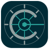

**A fast, native Kubernetes IDE for your desktop: Lens's workflows, a UI that reads from a live
cache, and AI agents that work with you, not behind your back.**

If you know Lens, you know Cogpit: the same navigator, lists, detail drawers, actions and
shortcuts, in an open-source app written in Go. Every list reads from a cache that the cluster's
watches keep current, so lists of 10,000 pods stay quick and opening a view again costs your API
server nothing. And every action is also a tool an agent can use over MCP, with you deciding what
it may change.

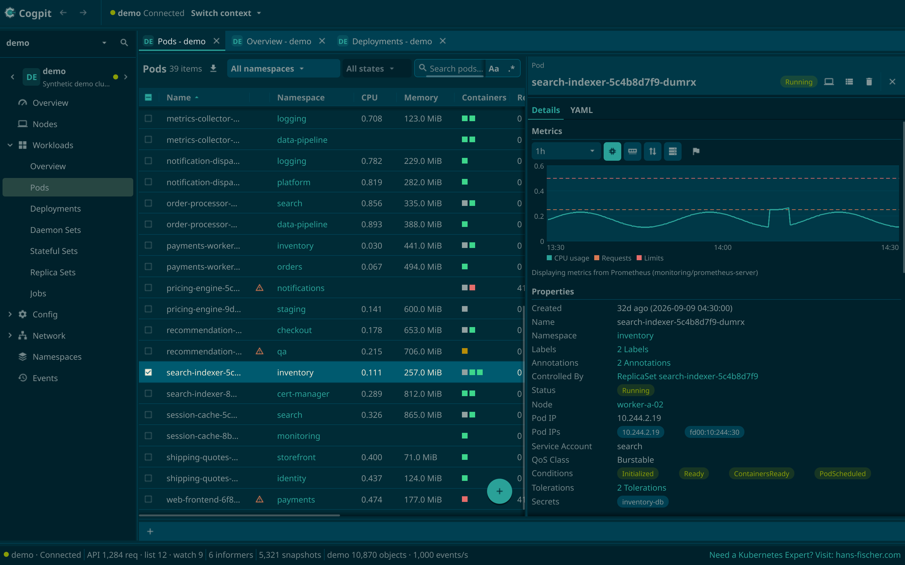

> **Pre-alpha.** Cogpit runs on macOS on Apple silicon today; Windows and Linux are planned after
> the macOS beta. Every view and action of Lens's list exists at least in part, but the releases
> are unsigned builds and nothing has been walked through by testers on real clusters yet: try it
> on the built-in demo cluster or a test cluster first. Where it stands, feature by feature:
> [ROADMAP.md](ROADMAP.md).

## ✨ Features

### 📋 Every resource, one click from its details

Workloads, config, network, storage, access control and every custom resource your cluster
serves, each in a list you can search (plain, match case or a regular expression) and narrow to
the states you care about: Running, Pending, CrashLoopBackOff, several at once (*beyond Lens*).
Pods and nodes show their CPU and memory from the Metrics Server or Prometheus; a pod's drawer
charts them per container against requests and limits, with Prometheus up to 30 days back
(pictured above).

### 🗺️ The cluster at a glance

The Overview charts CPU, memory and pods of your worker or control-plane nodes over the last hour
or longer, against requests, limits and capacity, and lists what is in trouble right below:
failing pods, unready nodes and workloads, warning events.

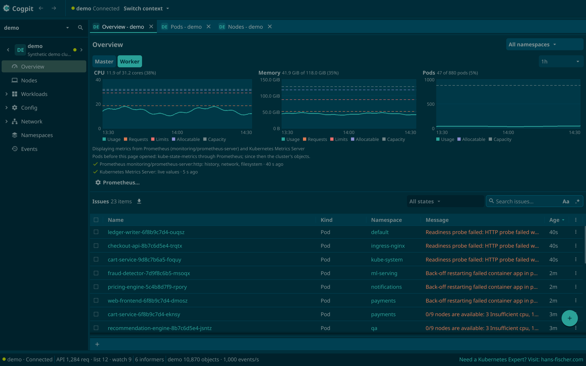

### 🖥️ Nodes and what runs on them

Usage bars for CPU, memory and disk (from node-exporter) in the Nodes list; a node's drawer shows
its capacity and the pods running on it with their CPU and memory. Cordon it, drain it (a drain
can be finished even if Cogpit quits halfway) or open a shell on it; the drain and the shell ask
first.

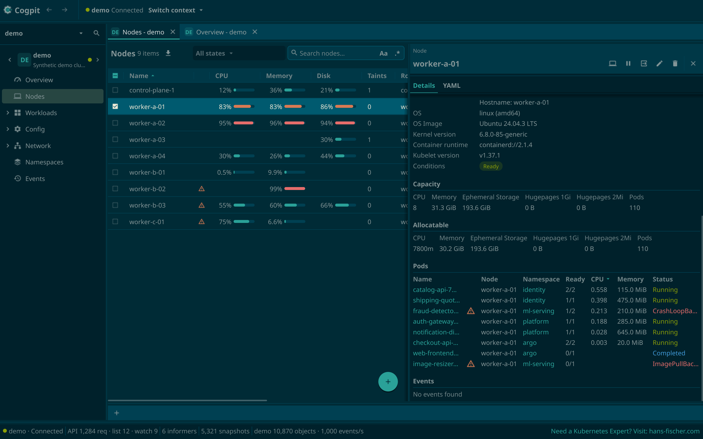

### 📜 Logs that follow a whole Deployment

Follow one container, or every pod of a Deployment, Stateful Set or Job in a single tab, each line
marked with its pod and container. Search highlights or filters; timestamps, the previous
container, older lines and a jump to a point in time are one click away.

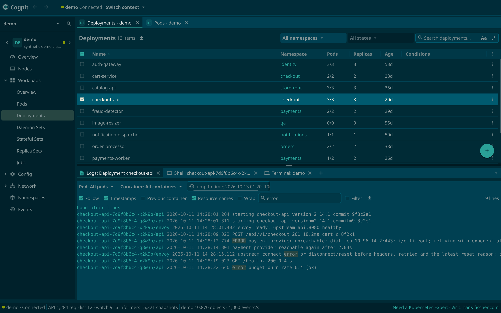

### 💻 Shells and a terminal

Open a shell in any container, attach to it, or open a terminal bound to the cluster's context.
Cogpit checks your `kubectl` against the cluster's version and offers a matching download,
verified against the Kubernetes release's signature, when yours is missing or too far off.

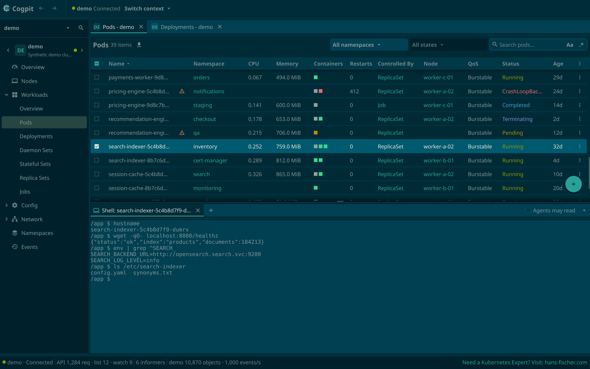

### ✏️ Edit YAML, see the diff, then apply

Edit any object in place. Before anything reaches the cluster you see the diff and the API
server's dry-run verdict, and if someone changed the object in the meantime, Cogpit tells you
instead of overwriting their change. Unsaved edits survive a crash.

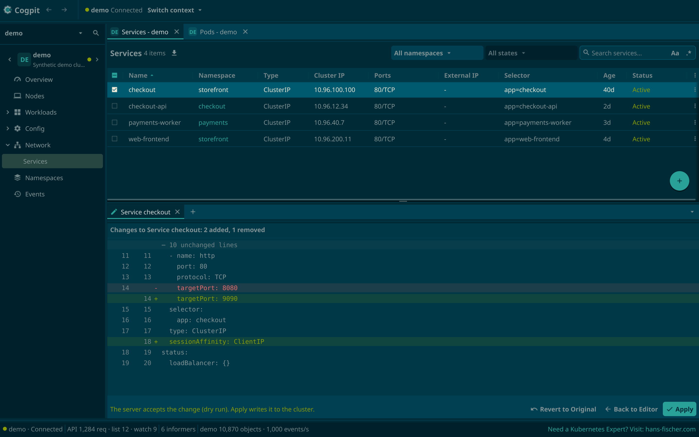

### ⎈ Helm, without the helm binary

Browse the charts of the repositories you already added with `helm repo add`, with their icons,
versions and each version's README, and install from a tab. Your releases show their history,
values and notes; upgrade to a newer chart version, roll back or uninstall, all through the Helm
SDK.

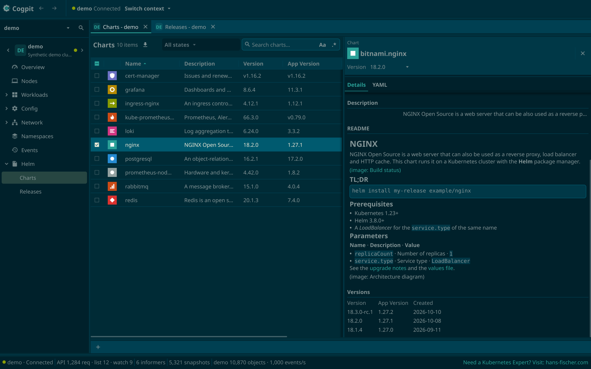

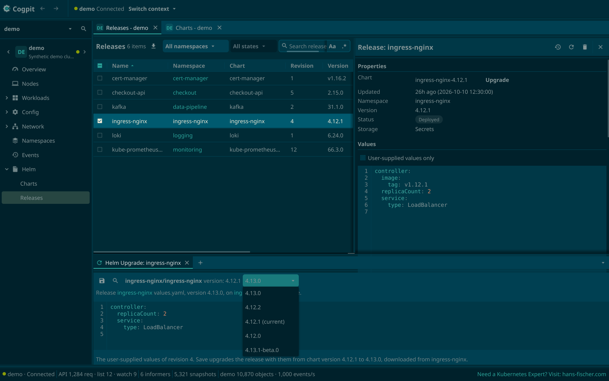

### 🔁 GitOps: Flux CD and Argo CD

Flux CD gets its own section: a dashboard of every Flux kind's state and what is not ready, with
Reconcile (with its source), Reset, Suspend and Resume on one object or a whole selection. Argo CD
shows your Applications' sync and health, the recent activity and what needs attention, with Sync,
Refresh and a way into the Argo CD UI.

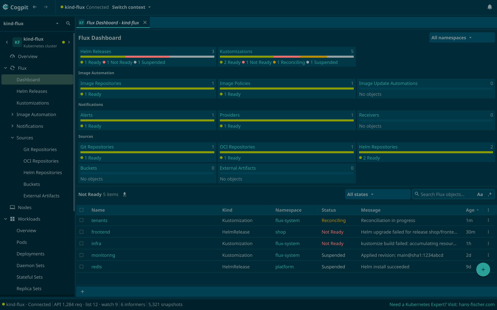

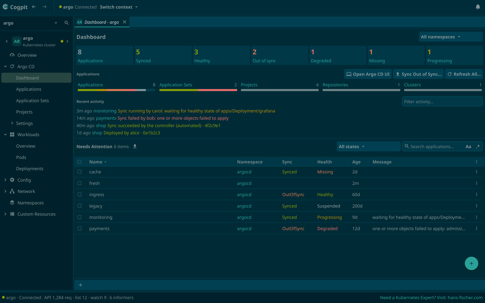

### 🗂️ All your clusters in one window

Cogpit reads every kubeconfig in `~/.kube` and the files and folders you add, each on its own, and
follows their changes. Pin clusters to the hotbar (F1–F12), keep tabs of several clusters open
(they come back after a restart), and reach any view, action or cluster from the command palette
(⌘⇧P).

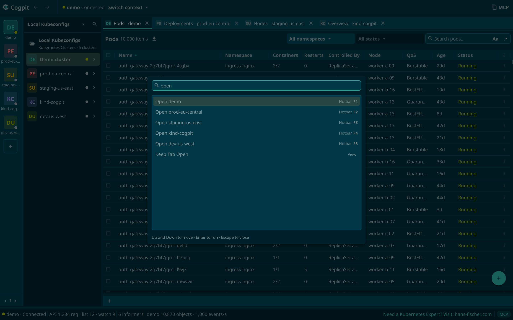

### 🔏 Certificates, decoded (*beyond Lens*)

A Secret's drawer decodes every certificate in it, PEM or DER: subject, issuer, names, validity
with a warning 30 days before it ends, key usage and fingerprints. Cogpit also checks that
`tls.key` belongs to `tls.crt` and that the chain is in order, without ever showing the key.

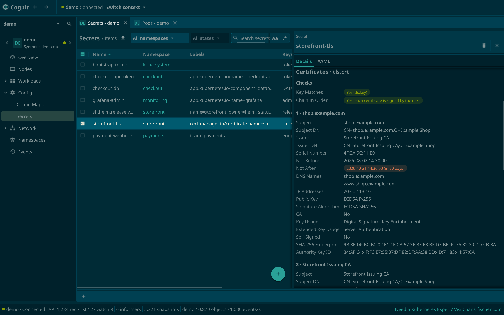

### 🤖 Agents over MCP, with you in control (*beyond Lens*)

Every command in Cogpit is also an MCP tool, so an agent such as Claude Code sees what you see,
reads lists and logs, and navigates the window for you. Reading is free; a change waits for your OK
in Cogpit's window, which names the objects, the namespace and the cluster (unless you allowed
changes on that cluster; destructive ones always wait), and Help › Audit Log shows everything
agents did. A few commands, such as creating a Secret, only you can run.

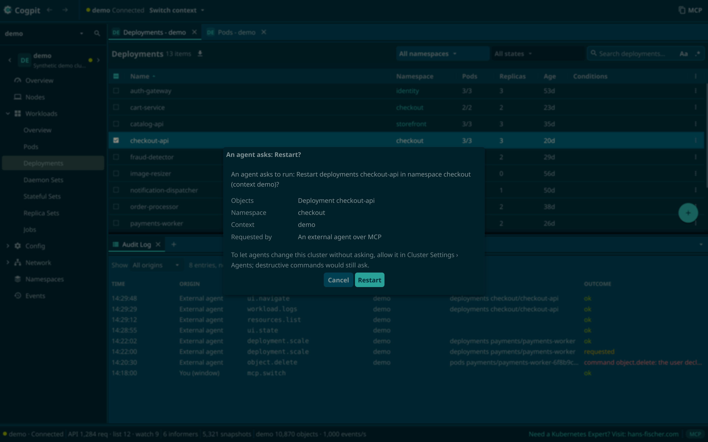

### 🌗 Dark or light

Solarized dark or light, or following your Mac's appearance, switched live in Preferences; every
time in your own time zone and your region's format.

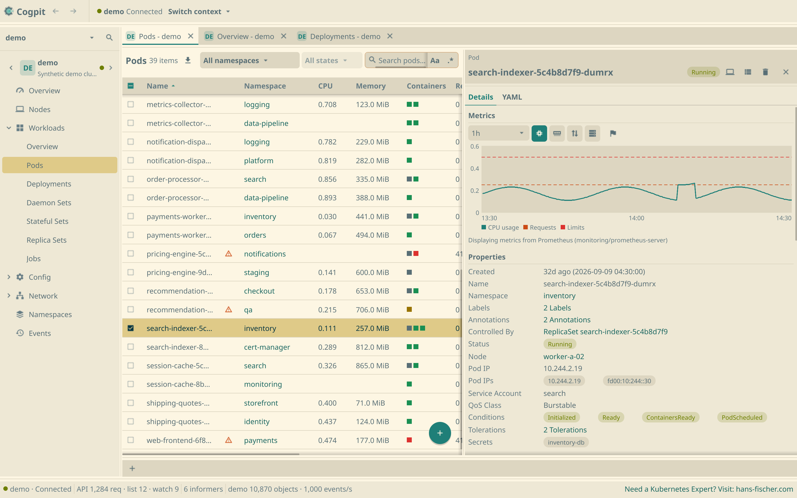

## 🛡️ Safe by design

- **Never surprises a cluster.** Browsing never writes, Cogpit installs nothing into your clusters
  unless you ask it to, and it never writes your kubeconfig files.
- **Asks before it destroys.** Delete, drain, evict, scale to zero, Helm rollback and uninstall
  and the node shell always ask first, naming the objects, the namespace and the cluster.
- **Agents ask too.** Agents read and navigate freely; anything they would change waits for your
  acceptance unless you allowed changes on that cluster, and destructive actions always wait.
- **Everything agents do is logged**, readable in Help › Audit Log.
- **Secrets stay secret.** Values stay masked until you reveal them, agents never read them, and
  tokens and keys never reach a log.
- **Your credentials stay yours.** Cogpit authenticates the way `kubectl` does, with your
  kubeconfig, and runs a credential plugin only after you allowed it.
- **Light on the API server.** Views read from a watch-fed cache: opening a view again costs no
  request.

## 🚀 Get Cogpit

**Download** the latest [release](https://github.com/guided-traffic/cogpit/releases): the app for
Apple silicon is `Cogpit_<version>_darwin_arm64.zip`. It is not signed with a Developer ID yet, so
macOS blocks its first start until you allow it in System Settings › Privacy & Security › Open
Anyway. No cluster at hand? Pick the **demo** cluster in the cluster picker (⌘P): a synthetic
cluster of 10,000 pods that lives inside Cogpit.

**`cogpit-cli`** (Linux, macOS and Windows, in every release) lists your contexts, prints any
kind's objects as Cogpit's views show them, and connects agents that speak only stdio to Cogpit's
MCP tools ([reference](docs/developer/usage.md#cogpit-cli)).

**Build from source** with Go and the Xcode Command Line Tools: `make run-demo` starts Cogpit on the
demo cluster ([run from source](docs/developer/usage.md#run-the-mvp)).

## 📚 Documentation

| Document | For |
|---|---|
| [Usage and reference](docs/developer/usage.md) | Running Cogpit, its flags and files, setting up an agent, `cogpit-cli` |
| [Commands and MCP tools](docs/developer/commands.md) | Every command an agent can call, with its danger level |
| [Developer documentation](docs/developer/README.md) | Architecture, conventions, testing, releasing, decisions |
| [Security architecture](docs/security/README.md) | Trust boundaries, credentials, privilege footprint, agents and MCP |
| [Parity with Lens](docs/parity/README.md) | What exists and what is missing, view by view |
| [ROADMAP.md](ROADMAP.md) | Where Cogpit stands and what comes next |
| [SECURITY.md](SECURITY.md) | Reporting a vulnerability |
| [AGENTS.md](AGENTS.md) | Contributing, for people and coding agents |

## License

[Apache-2.0](LICENSE). Cogpit is a clean-room reimplementation: it contains no code, text or
assets from Lens Desktop, OpenLens or Freelens, and it is not affiliated with or endorsed by
Mirantis, the maker of Lens Desktop. Third-party material, including the documentation method
adapted from PhotoCraft, is listed in [ATTRIBUTION.md](ATTRIBUTION.md).
