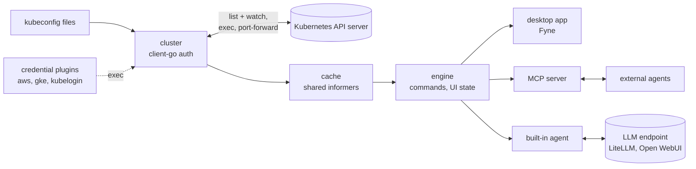

# Cogpit

[](LICENSE)

Cogpit is a native Kubernetes IDE for the desktop, written in Go: an open-source, clean-room
reimplementation of the current [Lens Desktop](https://lenshq.io/). It runs on your Mac first,
later on Windows and Linux. It reads your kubeconfig files, connects to your clusters with your
own credentials, and gives you the views Lens users know: workloads, logs, shells, YAML editing,
port forwarding and the Helm releases in your clusters. Every view reads from a cache that watches
keep current, so it is fast for you and light on the API server. And agents can drive all of it
over MCP, the UI included. Cogpit is a desktop client: it is never a web UI and is never deployed
into a cluster. **Status: pre-alpha. This repository holds the plan and its documentation; no code
exists yet** ([roadmap](ROADMAP.md)).



## ✨ Key Features

Planned; none is built yet. Progress against Lens is measured in [ROADMAP.md](ROADMAP.md).

- 🖥️ A native macOS app first, Windows and Linux (Ubuntu first) after the macOS beta.
- 🗂️ Every cluster from your kubeconfig files, synced folders or pasted text, side by side.
- 🔐 Your credentials stay yours: kubectl's own authentication code (certificates, tokens, exec plugins for EKS, GKE, AKS); no local proxy, no login.
- ⚡ Cache first: views read from a watch-fed cache; switching back to a view costs no API request.
- 📋 Lens's resource views: workloads, config, network, storage, access control, custom resources.
- 📜 Logs with follow, filter, timestamps and the previous container.
- 💻 Pod shells, attach, node shells, and a terminal bound to the cluster's context.
- ✏️ YAML editing with a diff and a server-side dry-run before every apply.
- 🔌 Port forwarding, one click to the browser.
- ⎈ The Helm releases in your clusters (Lens's Helm view): history, values, upgrade, rollback, through the Helm SDK, no `helm` binary needed.
- 📈 Metrics from metrics-server or Prometheus.
- 🛡️ Never surprises a cluster: destructive actions confirm, nothing is installed or written implicitly.
- 🤖 Fully controllable over MCP, the UI included: an agent sees what you see and navigates for you.
- 💬 A built-in agent in a chat beside your views, on any OpenAI-compatible endpoint such as LiteLLM or Open WebUI.
- 📦 Installs the Mac way: open the disk image, drag Cogpit into Applications; a Homebrew cask for shell users.
- ⬆️ Updates with one click (Sparkle), verified against a signed update feed.

## 📛 Naming conventions

Planned; nothing generates these names yet.

| What | Pattern | Example |
|---|---|---|
| Go module | `github.com/guided-traffic/cogpit` | |
| Binaries | `cogpit` (desktop app), `cogpit-cli` (headless CLI and MCP stdio bridge) | |
| Packages | `internal/<area>` | `internal/cache` # example |
| Command ids | `<kind-or-area>.<action>`, lowerCamelCase segments | `deployment.restart`, `ui.navigate` # example |
| MCP tool names | the command id with dots replaced by underscores | `deployment_restart`, `ui_navigate` # example |
| Environment variables | `COGPIT_<NAME>` | |
| Release artifacts | `Cogpit-<version>-macos-universal.dmg` (disk image with the app bundle `Cogpit.app`), `cogpit-cli-<version>-<os>-<arch>.tar.gz` | `Cogpit-0.1.0-macos-universal.dmg` # example |
| MCP bearer token | a file in the app's runtime directory, owner-only | |
| Pasted kubeconfigs | `<app data dir>/kubeconfigs/<id>.yaml`, owner-only | |
| Terminal kubeconfig | a temporary file per terminal holding only a context, deleted on close ([why](docs/security/credentials.md#the-terminals-kubeconfig)) | |
| Deep links | `cogpit://` | |

| Identifier | Meaning | Where |
|---|---|---|
| `G<n>` | A gap against Lens or a beyond-Lens target | [docs/parity/gaps.md](docs/parity/gaps.md) |
| `M<n>` | A milestone | [docs/parity/roadmap.md](docs/parity/roadmap.md) |
| `D-<n>` | A decision | [docs/developer/decisions.md](docs/developer/decisions.md) |
| `H-<n>` | An open security gap | [docs/security/](docs/security/README.md) |
| `P<n>` | A performance or API-load budget | [docs/developer/testing.md](docs/developer/testing.md#performance-budgets-proposed-not-measured) |
| `S<n>` | A gate criterion of the Fyne spike | [docs/developer/spike-fyne.md](docs/developer/spike-fyne.md#gate-criteria) |

## 📚 Documentation

| Document | For |
|---|---|
| [ROADMAP.md](ROADMAP.md) | One page: stage, numbers, what's next |
| [AGENTS.md](AGENTS.md) | Contributors and agents: the rules, how to pick work |
| [docs/parity/](docs/parity/README.md) | Where Cogpit stands against Lens: assessment, gaps, roadmap, checklists for [interface](docs/parity/ui-parity.md), [resources](docs/parity/resource-parity.md), [platforms](docs/parity/platform-parity.md) and [beyond Lens](docs/parity/beyond-lens.md) |
| [docs/developer/](docs/developer/README.md) | Architecture, conventions, extending, testing, releasing, [decisions](docs/developer/decisions.md), the [Fyne spike](docs/developer/spike-fyne.md) |
| [docs/security/](docs/security/README.md) | Trust boundaries, credentials, privilege footprint, agents and MCP, updates |
| [SECURITY.md](SECURITY.md) | Reporting a vulnerability |
| [ATTRIBUTION.md](ATTRIBUTION.md) | Third-party material |
| [Lens documentation](https://docs.lenshq.io/) | The target's behaviour |
| [client-go](https://github.com/kubernetes/client-go), [Fyne](https://fyne.io/), [MCP Go SDK](https://github.com/modelcontextprotocol/go-sdk) | The main building blocks |

## 🚀 TL;DR fast start

There is nothing to install yet; implementation starts when the owner gives the go-ahead. To follow
along or contribute:

```sh
git clone https://github.com/guided-traffic/Cogpit.git
cd Cogpit
```

Then read [ROADMAP.md](ROADMAP.md) for where things stand and [AGENTS.md](AGENTS.md) for how to
work here; the current focus is at the top of [docs/parity/roadmap.md](docs/parity/roadmap.md#current-focus).

## 📖 Full reference

No public interface exists yet. Each planned interface is specified where it will be built, and
this section will introduce them once they exist:

| Interface | Specified in |
|---|---|
| Commands (ids, parameters, verbs, confirmation) | [architecture §4.2](docs/developer/architecture.md#42-the-command-registry), ids in [resource-parity](docs/parity/resource-parity.md) |
| MCP tools and transport | [beyond Lens › MCP](docs/parity/beyond-lens.md#mcp-control-of-ui-and-cluster), [decision D-2](docs/developer/decisions.md#d-2-agent-interface-scope) |
| Built-in agent and LLM endpoint settings | [decision D-10](docs/developer/decisions.md#d-10-built-in-agent) |
| Preferences and cluster settings | [ui-parity › Preferences](docs/parity/ui-parity.md#preferences), [› Cluster settings](docs/parity/ui-parity.md#cluster-settings) |
| Kubeconfig handling and credentials | [security › credentials](docs/security/credentials.md) |

## 🛠 Development

Once milestone M0 creates the code, through the `Makefile` as in the team's other Go repositories:

```sh
make build
make run
make lint
make test-unit-race
make test
```

Everything else: [docs/developer/](docs/developer/README.md).

## License

[Apache-2.0](LICENSE). Third-party material, including the documentation method adapted from
PhotoCraft, is listed in [ATTRIBUTION.md](ATTRIBUTION.md). Cogpit is not affiliated with or
endorsed by Mirantis, the maker of Lens Desktop.
