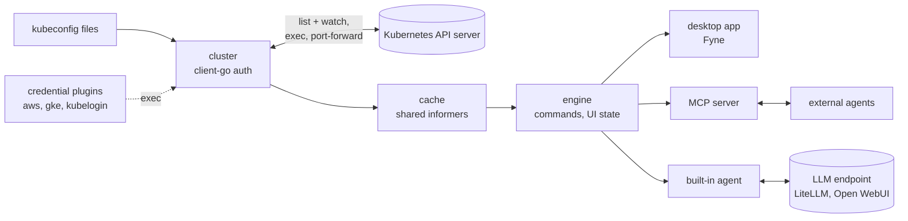

# Cogpit

[](https://github.com/guided-traffic/cogpit/actions)
[](https://github.com/guided-traffic/cogpit)
[](https://goreportcard.com/report/github.com/guided-traffic/cogpit)
[](LICENSE)

Cogpit is a native Kubernetes IDE for the desktop, written in Go: an open-source, clean-room
reimplementation of the current [Lens Desktop](https://lenshq.io/). It runs on your Mac first,
later on Windows and Linux. It reads your kubeconfig files, connects to your clusters with your
own credentials, and gives you the views Lens users know: workloads, logs, shells, YAML editing,
port forwarding and the Helm releases in your clusters. Every view reads from a cache that watches
keep current, so it is fast for you and light on the API server. And agents can drive all of it
over MCP, the UI included. Cogpit is a desktop client: it is never a web UI and is never deployed
into a cluster. **Status: pre-alpha. A local MVP runs on macOS** — 16 built-in views plus one per
custom resource kind, the detail drawer with row menus, YAML editing with diff and dry-run, node
and workload actions, logs, a terminal, a pod shell and MCP control of the UI
([Run the MVP](#run-the-mvp)); it is not a release ([roadmap](ROADMAP.md)).



## ✨ Key Features

Planned. The local MVP already has, in part: the context picker; views from the cache for Nodes,
Namespaces, Events, Pods, Deployments, Daemon Sets, Stateful Sets, Replica Sets, Jobs, Cron Jobs,
Services, Ingresses, Ingress Classes, Config Maps, Persistent Volume Claims, Custom Resource
Definitions and every custom resource kind (following the cluster's definitions live); the detail
drawer and row menus from the command registry; editing YAML with a diff, a server-side dry run
and a resourceVersion precondition; create from templates; Delete for every kind, Restart, Scale,
Cordon, Uncordon, a crash-safe Drain, Trigger, Suspend, Resume and Evict, destructive ones
confirmed; logs with follow, the cluster-bound terminal, the pod shell; and MCP control of all of
it. Progress against Lens is measured in [ROADMAP.md](ROADMAP.md).

- 🖥️ A native macOS app first, Windows and Linux (Ubuntu first) after the macOS beta.
- 🗂️ Every cluster from your kubeconfig files and synced folders, side by side.
- 🔐 Your credentials stay yours: kubectl's own authentication code (certificates, tokens, exec plugins for EKS, GKE, AKS); no local proxy, no login.
- ⚡ Cache first: views read from a watch-fed cache; switching back to a view costs no API request.
- 📋 Lens's resource views: workloads, config, network, storage, access control, custom resources.
- 📜 Logs with follow, filter, timestamps and the previous container.
- 💻 Pod shells, attach, node shells, and a terminal bound to the cluster's context.
- ✏️ YAML editing with a diff and a server-side dry-run before every apply.
- 🔌 Port forwarding, one click to the browser.
- ⎈ The Helm releases in your clusters (Lens's Helm view): history, values, upgrade, rollback, through the Helm SDK, no `helm` binary needed.
- 📈 Metrics from metrics-server or Prometheus.
- 🛡️ Never surprises a cluster: destructive actions confirm, nothing is installed or written implicitly.
- 🤖 Fully controllable over MCP, the UI included: an agent sees what you see and navigates for you.
- 💬 A built-in agent in a chat beside your views, on any OpenAI-compatible endpoint such as LiteLLM or Open WebUI.
- 📦 Installs the Mac way: open the disk image, drag Cogpit into Applications; a Homebrew cask for shell users.
- ⬆️ Updates with one click (Sparkle), verified against a signed update feed.

## 📛 Naming conventions

Names Cogpit generates or expects. Paths are macOS paths; `<user config dir>` is
`~/Library/Application Support`, `<user cache dir>` is `~/Library/Caches`.

| What | Pattern | Example |
|---|---|---|
| Go module | `github.com/guided-traffic/cogpit` | |
| Binaries | `cogpit` (desktop app), `cogpit-cli` (headless CLI and MCP stdio bridge; a stub today) | |
| App bundle | `Cogpit.app`, bundle id `io.guided-traffic.cogpit` | `bin/Cogpit.app` # example |
| Packages | `internal/<area>` | `internal/cache` # example |
| Command ids | `<kind-or-area>.<action>`, lowerCamelCase segments | `deployment.restart`, `ui.navigate` |
| MCP tool names | the command id with dots replaced by underscores | `deployment_restart`, `ui_navigate` |
| Kind keys (views, `kind` parameters) | the plural resource name for built-in kinds; `<plural>.<group>` for kinds from custom resource definitions ([why](docs/developer/architecture.md#45-kind-keys)) | `pods`, `services`, `gateways.gateway.networking.k8s.io` |
| Environment variables | `COGPIT_<NAME>`; today only the test variables `COGPIT_KIND_KUBECONFIG`, `COGPIT_KIND_CONTEXT` and `COGPIT_PNG_DIR` | |
| MCP endpoint | `http://127.0.0.1:<random port>/mcp`, new port on every start | `http://127.0.0.1:59449/mcp` # example |
| MCP bearer token | `<user config dir>/Cogpit/mcp-token`, owner-only (0600, directory 0700), new on every start, removed on exit | |
| Audit log | `<user config dir>/Cogpit/audit.log`, owner-only, one JSON line per agent-initiated command | |
| Drain journal | `<user config dir>/Cogpit/drains.json`, owner-only (0600, directory 0700): the drains Cogpit started and has not finished, offered again on the next connect | |
| App log | `<user cache dir>/Cogpit/cogpit.log`, and stderr | |
| Terminal kubeconfig | a temporary file per terminal holding only a context, owner-only, deleted on close ([why](docs/security/credentials.md#the-terminals-kubeconfig)) | |
| Demo context | `demo` (the synthetic cluster) | |
| Local kind cluster | cluster `cogpit`, context `kind-cogpit`, kubeconfig `.cache/kind/kubeconfig` | |
| Release artifacts (planned) | `Cogpit-<version>-macos-universal.dmg`, `cogpit-cli-<version>-<os>-<arch>.tar.gz` | `Cogpit-0.1.0-macos-universal.dmg` # example |
| Deep links (planned) | `cogpit://` | |

| Identifier | Meaning | Where |
|---|---|---|
| `G<n>` | A gap against Lens or a beyond-Lens target | [docs/parity/gaps.md](docs/parity/gaps.md) |
| `M<n>` | A milestone | [docs/parity/roadmap.md](docs/parity/roadmap.md) |
| `D-<n>` | A decision | [docs/developer/decisions.md](docs/developer/decisions.md) |
| `H-<n>` | An open security gap | [docs/security/](docs/security/README.md) |
| `P<n>` | A performance or API-load budget | [docs/developer/testing.md](docs/developer/testing.md#performance-budgets-proposed-not-measured) |
| `S<n>` | A gate criterion of the Fyne spike | [docs/developer/spike-fyne.md](docs/developer/spike-fyne.md#gate-criteria) |

## 📚 Documentation

| Document | For |
|---|---|
| [ROADMAP.md](ROADMAP.md) | One page: stage, numbers, what's next |
| [AGENTS.md](AGENTS.md) | Contributors and agents: the rules, how to pick work |
| [docs/parity/](docs/parity/README.md) | Where Cogpit stands against Lens: assessment, gaps, roadmap, checklists for [interface](docs/parity/ui-parity.md), [resources](docs/parity/resource-parity.md), [platforms](docs/parity/platform-parity.md) and [beyond Lens](docs/parity/beyond-lens.md) |
| [docs/developer/](docs/developer/README.md) | Architecture, conventions, extending, testing, releasing, [decisions](docs/developer/decisions.md), the [Fyne spike](docs/developer/spike-fyne.md) |
| [docs/security/](docs/security/README.md) | Trust boundaries, credentials, privilege footprint, agents and MCP, updates |
| [SECURITY.md](SECURITY.md) | Reporting a vulnerability |
| [ATTRIBUTION.md](ATTRIBUTION.md) | Third-party material |
| [Lens documentation](https://docs.lenshq.io/) | The target's behaviour |
| [client-go](https://github.com/kubernetes/client-go), [Fyne](https://fyne.io/), [MCP Go SDK](https://github.com/modelcontextprotocol/go-sdk) | The main building blocks |

## 🚀 TL;DR fast start

### Run the MVP

The MVP is a local build for macOS (tested on Apple silicon, macOS 26). It needs Go (1.26 or
later; the build fetches Go 1.27.2 itself), the Xcode Command Line Tools (Fyne uses cgo), and for
the kind cluster Docker, `kind` and `kubectl`.

```sh
git clone https://github.com/guided-traffic/Cogpit.git
cd Cogpit

make run-demo                 # synthetic cluster: 10,000 pods, 1,000 watch events per second

make kind-up                  # a kind cluster "cogpit" with its own kubeconfig (.cache/kind/kubeconfig)
make run                      # Cogpit connected to it; make kind-down removes it

make build && bin/cogpit      # your own clusters: picks contexts from $KUBECONFIG or ~/.kube/config
make app                      # bin/Cogpit.app (ad-hoc signed), starts by double-click
```

`make kind-up` seeds the namespace `cogpit-demo` ([hack/kind](hack/kind/README.md)): deployments
`web` and `api`, a crash-looping pod, a completed job, a `toolbox` pod with a shell, and the Service
`web` with the ClusterIP `10.96.100.100`. Nothing touches `~/.kube/config`.

**Drive it with an agent.** At start, Cogpit prints a ready-to-paste command:

```sh
claude mcp remove --scope user cogpit >/dev/null 2>&1; claude mcp add --scope user --transport http cogpit http://127.0.0.1:<port>/mcp --header "Authorization: Bearer <token>"
```

Run it, then ask Claude Code "show me the Service with ClusterIP 10.96.100.100": Cogpit opens
Services, selects `web` and opens its drawer. Port and token change on every start, so repeat the
command after a restart. Agents may read and navigate freely; Restart, Delete and the pod shell
wait for your confirmation in Cogpit's window ([agents and MCP](docs/security/agents-and-mcp.md)).

**Verify.** `make test-unit-race` runs every test without a cluster; with the kind cluster up,
`make test-kind` also runs the cluster tests (views, logs, pod shell, `kubectl` in the terminal).

**Not in the MVP:** editing and applying YAML, scale, port forwarding, Helm, metrics, attach and
node shells, the command palette, preferences, Windows and Linux, signed releases.

<details>
<summary>Clean up</summary>

```sh
make kind-down     # deletes the kind cluster and its kubeconfig file
make clean         # removes bin/ and dist/
rm -rf ~/Library/Caches/Cogpit "~/Library/Application Support/Cogpit"   # logs, audit log, token
```

</details>

## 📖 Full reference

### `cogpit` flags

| Flag | Default | Meaning |
|---|---|---|
| `--kubeconfig <files>` | empty: `$KUBECONFIG`, else `~/.kube/config` # default | kubeconfig files, separated by `:` |
| `--context <name>` | empty: show the context picker # default | connect to this context at start |
| `--demo` | `false` # default | connect to the synthetic demo cluster |
| `--demo-pods <n>` | `10000` # default | pods in the demo cluster |
| `--demo-events <n>` | `1000` # default | watch events per second in the demo cluster |
| `--mcp-addr <addr>` | `127.0.0.1:0` # default | MCP listen address; anything but a loopback address is refused |
| `--no-mcp` | `false` # default | do not start the MCP server |
| `--perf <duration>` | `0` # default | measure main-loop latency while auto-scrolling the table, print it as JSON and quit |
| `--theme <mode>` | `dark` # default | `dark` (Solarized Dark), `light` (Solarized Light) or `system` |
| `-v` | `false` # default | debug logging |

Security note on `--mcp-addr`: the server checks `Host`, `Origin` and the bearer token, and binds
loopback addresses only, because any reachable listener would let others drive Cogpit with your
cluster identities.

### Commands and MCP tools

Every command is an MCP tool (dots become underscores). `?` marks optional parameters; `ref` is
`{context?, kind, namespace?, name}`. Danger decides confirmation: `destructive` always asks in
Cogpit's window, `mutating` asks when an agent calls it, `read` and `ui` never ask
([D-2](docs/developer/decisions.md#d-2-agent-interface-scope)). The table is generated from the
registry with `go run ./hack/readmecmds`.

<details>
<summary>All 76 commands</summary>

| Command | MCP tool | Danger | Parameters | What it does |
|---|---|---|---|---|
| `cluster.connect` | `cluster_connect` | ui | `context` | Connects to a kubeconfig context (or the demo cluster) and opens its Pods view, replacing the current connection |
| `cluster.connectLog` | `cluster_connectLog` | read | `context` | Returns the log of the last attempt to connect to a context this session (and of a connection Cogpit closed because its kubeconfig file went away): lines with a time, a level (INFO or ERROR) and a text |
| `cluster.contexts` | `cluster_contexts` | read |  | Lists the kubeconfig contexts Cogpit can connect to (name, cluster, user, default namespace, server, whether it is the kubeconfig's current context) and the synthetic demo cluster if offered |
| `cluster.refreshAccess` | `cluster_refreshAccess` | read |  | Asks the API server again what the connected user may do (SelfSubjectRulesReview per namespace, SelfSubjectAccessReview where rules cannot answer) and drops the answers Cogpit kept since connecting: use it after the user's roles changed |
| `cronjob.resume` | `cronjob_resume` | mutating | `ref` | Resumes a suspended cron job: sets spec.suspend to false, so that it runs on its schedule again |
| `cronjob.suspend` | `cronjob_suspend` | mutating | `ref` | Suspends a cron job: sets spec.suspend to true, so that it starts no Jobs on its schedule; running Jobs go on |
| `cronjob.trigger` | `cronjob_trigger` | mutating | `ref` | Runs a cron job now, as kubectl create job --from=cronjob/<name> does: creates a Job from the cron job's job template, with its labels and annotations, the annotation cronjob.kubernetes.io/instantiate=manual and the cron job as its controller, named <cronjob>-manual-<5 random characters> (within 63 characters) |
| `daemonset.restart` | `daemonset_restart` | destructive | `ref` | Restarts a daemon set the way kubectl rollout restart does: it sets the pod template's kubectl.kubernetes.io/restartedAt annotation, and the controller replaces every pod by its update strategy (with OnDelete, only as pods are deleted) |
| `deployment.restart` | `deployment_restart` | destructive | `ref` | Restarts a Deployment the way kubectl rollout restart does: it sets the pod template's restartedAt annotation and the controller replaces every pod |
| `deployment.scale` | `deployment_scale` | mutating (destructive for some calls) | `ref`, `replicas`? | Sets a deployment's replica count, as kubectl scale does: a patch of spec.replicas on its scale subresource |
| `dock.activate` | `dock_activate` | ui | `id` | Shows a dock tab |
| `dock.close` | `dock_close` | ui | `id` | Closes a dock tab and ends its stream or shell |
| `editor.diff` | `editor_diff` | read | `context`?, `id`, `yaml`? | Returns the line diff of an Edit tab's text (or of yaml) against the object as Cogpit's cache holds it now: lines with op "-" (removed), "+" (added) or "=" (context), with line numbers |
| `editor.get` | `editor_get` | read | `id` | Returns an editor tab's text (what the user has typed so far) and its revision; for an Edit tab also the resourceVersion the edit is based on, the one Cogpit's cache holds now, and whether they differ (stale: an apply would be refused with a conflict) or the object is gone (missing); for a Helm Upgrade tab the release revision its values are based on |
| `editor.setText` | `editor_setText` | ui | `id`, `yaml` | Replaces an editor tab's text, as typing does; the tab shows it unless the user has unsaved typing of their own |
| `helm.dismissOperation` | `helm_dismissOperation` | ui | `ref` | Forgets an unfinished Helm action from helm_pendingOperations without changing the cluster: the release stays as it is (pending-rollback or uninstalling, unless someone changed it) |
| `helm.pendingOperations` | `helm_pendingOperations` | read | `all`? | Lists the Helm rollbacks, uninstalls and upgrades Cogpit started on the connected context (all: on every context) that did not finish: context, namespace, release, action, the target revision of a rollback, the revision an upgrade started from (fromRevision) and its chart, when and by whom started, status (running in this Cogpit or, with elsewhere and its owner's process, in another one, interrupted by an earlier run of Cogpit ending, or failed with its error) and the release's status from the cache (pending-rollback, pending-upgrade, uninstalling, deployed, missing, unknown) |
| `helm.release.history` | `helm_release_history` | read | `ref` | Returns a release's revisions from Cogpit's cache, newest first (as many as Helm keeps, ten by default): each revision's chart and version, app version, status, when it was deployed and its description, with the release's newest revision and status |
| `helm.release.rollback` | `helm_release_rollback` | destructive | `ref`, `revision` | Rolls a Helm release back to an earlier revision of its history, as helm rollback does with its defaults (hooks waited for, ten revisions kept): a new revision with that revision's chart, values and manifest, and the release's objects changed to it |
| `helm.release.uninstall` | `helm_release_uninstall` | destructive | `ref` | Uninstalls a Helm release as helm uninstall does with its defaults: runs its hooks, deletes every object of the release and its history |
| `helm.release.upgrade` | `helm_release_upgrade` | mutating | `ref`, `revision`?, `tab`?, `textRevision`?, `values`?, `version`? | Upgrades a Helm release as helm upgrade does with its defaults (hooks waited for, ten revisions kept), with the release's own chart and new user-supplied values, which replace the old ones whole: the values of a Helm Upgrade tab (tab), or values given here with the revision they are based on |
| `helm.release.upgradeTab` | `helm_release_upgradeTab` | ui | `ref` | Opens a release's Helm Upgrade dock tab, or activates the one already open on it: the release's chart, the version the upgrade installs (the release's own: Cogpit has no chart repositories yet) and its user-supplied values in an editor, read from Cogpit's cache |
| `helm.release.values` | `helm_release_values` | read | `all`?, `ref` | Returns a release's values from Cogpit's cache, the newest revision's: the user-supplied ones, or all of them with the chart's defaults (all), with the revision and chart they are of |
| `kinds.list` | `kinds_list` | read |  | Lists the kinds the connected cluster serves, as Cogpit shows them: kind key (what other tools take as kind), title, Kubernetes kind, group, version, whether it is namespaced, its table columns, and the fields resources_find can search by |
| `kubeconfig.addFile` | `kubeconfig_addFile` | ui | `path` | Adds a kubeconfig file the user picked as a source: its contexts become available as "<context> [<file name>]", read from that file alone, and follow its changes |
| `kubeconfig.addFolder` | `kubeconfig_addFolder` | ui | `path` | Adds a sync folder: every kubeconfig file in it (not in its subfolders) becomes available as "<context> [<folder>/<file>]", and files that appear in it or leave it later are picked up or dropped |
| `kubeconfig.approveExec` | `kubeconfig_approveExec` | ui | `context`, `fingerprint` | Records that the user allows a kubeconfig source context's credential plugin to run, exactly as shown (the fingerprint binds the command, its arguments, its environment and the server); a later change asks again |
| `kubeconfig.execPlugin` | `kubeconfig_execPlugin` | read | `context` | Describes how a kubeconfig source's context logs in when that needs the user's approval: the credential plugin (users[].user.exec) it runs and a token file (users[].user.tokenFile) outside the kubeconfig's folder |
| `kubeconfig.remove` | `kubeconfig_remove` | ui | `source` | Removes a kubeconfig source, which is Cogpit's link to a file or folder and nothing else: its contexts are no longer offered, the credential plugins allowed for its files are forgotten, and an open connection made from one of its files is closed |
| `kubeconfig.sources` | `kubeconfig_sources` | read |  | Lists the kubeconfig sources the user added in Cogpit: kubeconfig files and sync folders, each with its id, kind, path, the files read from it, how many contexts it offers and why it cannot be read |
| `logs.controller` | `logs_controller` | read | `id` | Turns a pod's logs tab into the logs of the resource that controls the pod (its Deployment, Daemon Set, Stateful Set, Replica Set or Job; a Deployment's pods through their replica set), as workload_logs shows them: every pod's containers, each line with its pod and container |
| `logs.setOptions` | `logs_setOptions` | ui | `filter`?, `id`, `previous`?, `resourceNames`?, `search`?, `timestamps`?, `wrap`? | Changes a logs tab's options, as the tab's toolbar does: previous (the previous terminated container's log), timestamps, resourceNames, wrap, search and filter |
| `node.cordon` | `node_cordon` | mutating | `ref` | Cordons a node as kubectl cordon does: sets spec.unschedulable, so that no new pods are scheduled on it; running pods stay |
| `node.dismissDrain` | `node_dismissDrain` | ui | `ref` | Forgets an unfinished drain from node_pendingDrains without changing the cluster: the node stays as it is (cordoned and partly drained, unless someone changed it) |
| `node.drain` | `node_drain` | destructive | `deleteEmptyDirData`?, `force`?, `gracePeriodSeconds`?, `ignoreDaemonSets`?, `ref`, `timeoutSeconds`? | Drains a node as kubectl drain does: cordons it, then evicts every pod on it through the eviction API, which honours PodDisruptionBudgets, and waits until they are gone |
| `node.pendingDrains` | `node_pendingDrains` | read | `all`? | Lists the drains Cogpit started on the connected context (all: on every context) that did not finish: context, node, when and by whom started, the settings, status (running in this Cogpit or, with elsewhere and its owner's process, in another one, interrupted by an earlier run of Cogpit ending, or failed with its error) and the node's state from the cache (cordoned, schedulable, missing, unknown) |
| `node.uncordon` | `node_uncordon` | mutating | `ref` | Uncordons a cordoned node as kubectl uncordon does: removes spec.unschedulable, so that pods are scheduled on it again |
| `object.apply` | `object_apply` | mutating (destructive for some calls) | `id`, `textRevision`?, `yaml`? | Writes an Edit tab's text at textRevision (or yaml) to the cluster: a server-side dry run, then an update with the resourceVersion the edit is based on as precondition |
| `object.copyName` | `object_copyName` | ui | `ref` | Returns an object's name, as the detail drawer's Copy does for the user, who gets it on the clipboard |
| `object.create` | `object_create` | mutating | `namespace`?, `yaml` | Creates the objects of a YAML text (several documents separated by ---) in order, each after a server-side dry run; an object that fails is reported and the next one is tried |
| `object.delete` | `object_delete` | destructive | `ref` | Deletes an object of any kind with its default grace period, with the UID Cogpit's cache holds for it as a precondition, so that an object created again under the same name is not deleted; its dependents are garbage-collected, and its controller, if any, may replace it |
| `object.dryRun` | `object_dryRun` | read | `id`, `yaml`? | Sends an Edit tab's text (or yaml) to the API server as an update with dryRun=All: the server validates it and runs admission, and stores nothing |
| `object.edit` | `object_edit` | ui | `ref` | Opens a dock tab with an object's YAML from Cogpit's cache (managed fields dropped) for editing, or activates the tab already open on it |
| `object.get` | `object_get` | read | `noYaml`?, `ref` | Returns what the detail drawer shows for one object, from Cogpit's cache: title, status, the sections (Properties first: the metadata and the kind's state; then the kind's own sections; values that name objects carry a link ref), its events (newest first, at most 50), its container names for pods, and its YAML (managed fields dropped, Secret values redacted) unless noYaml. missing is true when the object is not in the cache |
| `pod.attach` | `pod_attach` | mutating | `container`?, `ref` | Opens a dock tab attached to a container's main process, as kubectl attach does: its output from now on and, when the container was started with stdin (and a TTY), what is typed there as its input |
| `pod.evict` | `pod_evict` | destructive | `ref` | Evicts a pod through the eviction API, which honours PodDisruptionBudgets: the pod is deleted with its grace period and its controller, if any, starts a replacement |
| `pod.logs` | `pod_logs` | read | `container`?, `ref` | Opens a dock tab that follows a container's log (the last 1,000 lines, then new ones), or activates the tab already open for that pod and container |
| `pod.portForward` | `pod_portForward` | mutating | `container`?, `https`?, `localPort`?, `openInBrowser`?, `port`, `ref` | Forwards a port of a pod to a local port on 127.0.0.1 (only loopback; every local process can connect while it runs), as kubectl port-forward does, and keeps it up: it connects again when the connection is lost while the pod exists, and ends when the user stops it or Cogpit leaves the cluster |
| `pod.shell` | `pod_shell` | mutating | `container`?, `ref` | Opens a dock tab with an interactive shell in a container (bash, else ash, else sh) |
| `portforward.edit` | `portforward_edit` | mutating | `https`?, `localPort`?, `openInBrowser`?, `ref` | Starts a port forward again with new settings (local port, https, open in browser); a stopped or failed forward starts again too |
| `portforward.open` | `portforward_open` | ui | `ref` | Returns a port forward's URL, http(s)://127.0.0.1:<port>; the GUI opens it in the browser |
| `portforward.remove` | `portforward_remove` | ui | `ref` | Stops a port forward and removes it from the list |
| `portforward.stop` | `portforward_stop` | ui | `ref` | Stops a port forward: its local port closes and its connection to the pod ends |
| `replicaset.scale` | `replicaset_scale` | mutating (destructive for some calls) | `ref`, `replicas`? | Sets a replica set's replica count, as kubectl scale does: a patch of spec.replicas on its scale subresource |
| `resource.createTab` | `resource_createTab` | ui | `template`?, `yaml`? | Opens a Create resource dock tab with yaml, with a template (resource_templates lists them), or with an example Pod |
| `resource.templates` | `resource_templates` | read |  | Lists Cogpit's templates for new objects, one per kind in alphabetical order, each with its apiVersion, whether the kind is namespaced, and its YAML (without a namespace) |
| `resources.find` | `resources_find` | read | `field`, `kind`?, `limit`?, `match`?, `value` | Finds objects by a field value in Cogpit's cache, e.g. the Service with clusterIP 10.96.0.1 ({kind: services, field: clusterIP, value: 10.96.0.1}) or the pods on a node |
| `resources.list` | `resources_list` | read | `filter`?, `kind`, `limit`?, `namespaces`? | Lists objects of one kind from Cogpit's cache, as table rows: reference, status and the cells by column title |
| `secret.reveal` | `secret_reveal` | read | `key`, `ref`, `resourceVersion`? | Shows the user one value of the Secret open in the drawer, in Cogpit's own window (the drawer lists the keys with their values masked) |
| `service.portForward` | `service_portForward` | mutating | `https`?, `localPort`?, `openInBrowser`?, `port`, `ref` | Forwards a service's port to a local port on 127.0.0.1 (only loopback; every local process can connect while it runs) through a ready pod of the service's selector, at the port the service targets, as kubectl port-forward svc/<name> does |
| `statefulset.restart` | `statefulset_restart` | destructive | `ref` | Restarts a stateful set the way kubectl rollout restart does: it sets the pod template's kubectl.kubernetes.io/restartedAt annotation, and the controller replaces every pod by its update strategy (with OnDelete, only as pods are deleted) |
| `statefulset.scale` | `statefulset_scale` | mutating (destructive for some calls) | `ref`, `replicas`? | Sets a stateful set's replica count, as kubectl scale does: a patch of spec.replicas on its scale subresource |
| `table.exportCsv` | `table_exportCsv` | read | `view`? | Exports the open view's table as CSV text, as the download button beside the item count does: a header row with the titles of the visible columns, then the rows as the table shows them (namespace filter, search and sort applied; ages relative to now) |
| `terminal.open` | `terminal_open` | ui |  | Opens a dock tab with a local shell whose kubectl is bound to the connected context and to the namespace filter if it names exactly one namespace |
| `ui.closeDrawer` | `ui_closeDrawer` | ui |  | Closes the detail drawer |
| `ui.navigate` | `ui_navigate` | ui | `ref` | Shows one object to the user: opens its kind's view, makes sure the namespace filter and the search text do not hide it (resetting them if they do), selects it and opens its detail drawer |
| `ui.openView` | `ui_openView` | ui | `view` | Opens the list view of a kind (pods, services, ...) or a page (workloads/overview, the Workloads Overview), as clicking it in the sidebar does |
| `ui.select` | `ui_select` | ui | `noDrawer`?, `refs`? | Selects objects of the open view and, unless noDrawer is true, opens the detail drawer on the first one |
| `ui.setColumns` | `ui_setColumns` | ui | `hidden`?, `reset`?, `view`? | Shows and hides the columns of a view, as the ⋮ at the end of the table's header does: hidden lists the column ids to hide, every other column is shown |
| `ui.setFilter` | `ui_setFilter` | ui | `filter`? | Sets the search text of the open view: a row is shown when every whitespace-separated term occurs, case-insensitively, in one of its cells |
| `ui.setGroups` | `ui_setGroups` | ui | `groups`? | Sets the API group filter of the Definitions view (customresourcedefinitions), which Lens shows in place of the namespace filter: only the definitions of these groups are listed |
| `ui.setNamespace` | `ui_setNamespace` | ui | `namespaces`? | Sets the namespace filter of the namespaced views; an empty list shows all namespaces |
| `ui.sort` | `ui_sort` | ui | `column`, `desc`? | Sorts the open view by a column id (name, namespace, age, ... as kinds_list reports them), ascending unless desc is true |
| `ui.state` | `ui_state` | read |  | Returns what the user sees: the connected context and its connection state, the open view (kind key), the namespace filter, the search text, the sort order, the selected objects, the object in the detail drawer, the dock tabs, and how many rows the view shows of how many objects |
| `workload.logs` | `workload_logs` | read | `ref` | Opens a dock tab with the logs of every container of every pod a Deployment, Daemon Set, Stateful Set, Replica Set or Job controls (a Deployment's through its replica sets), each line starting with <pod>/<container>, and follows them: pods and restarted containers join as they start |
| `workloads.overview` | `workloads_overview` | read | `events`?, `namespaces`? | Reads the Workloads Overview: for each workload kind the cluster serves (pods, deployments, daemon sets, stateful sets, replica sets, jobs, cron jobs) the number of objects in the selected namespaces and their health, as counts per status token (ok, succeeded, pending, warning, error, terminating, unknown, and none); with events, also the events of those namespaces |
</details>

### Make targets

| Target | What it does |
|---|---|
| `make build` | `bin/cogpit` (cgo, Fyne) and `bin/cogpit-cli` (pure Go) |
| `make run`, `make run-demo` | run against the kind cluster, or the demo cluster |
| `make test-unit-race`, `make test` | every test without a cluster, race detector on |
| `make test-kind` | cluster tests against the kind cluster (build tag `kind`) |
| `make test-unit-coverage`, `make coverage-badge` | the race tests with a coverage profile; `.github/badges/coverage.json` from it (CI keeps it current on main) |
| `make vuln` | govulncheck over the code paths Cogpit calls |
| `make kind-drain-up`, `make test-kind-drain`, `make kind-drain-down` | a separate three-node kind cluster (`cogpit-drain`, own kubeconfig `.cache/kind-drain/kubeconfig`) for the cordon, uncordon and drain tests |
| `make bench` | the gate benchmarks (S1, S2) |
| `make lint`, `make fmt` | golangci-lint v2.14.0 (installed into `bin/`) with the team's linters and the `depguard` layering |
| `make kind-up`, `make kind-seed`, `make kind-down` | the local kind cluster and its seed |
| `make app` | `bin/Cogpit.app` via `fyne package` |

## 🛠 Development

Through the `Makefile`, as in the team's other Go repositories:

```sh
make build
make lint
make test-unit-race
make test-kind      # needs make kind-up
```

Everything else: [docs/developer/](docs/developer/README.md).

## License

[Apache-2.0](LICENSE). Third-party material, including the documentation method adapted from
PhotoCraft, is listed in [ATTRIBUTION.md](ATTRIBUTION.md). Cogpit is not affiliated with or
endorsed by Mirantis, the maker of Lens Desktop.
