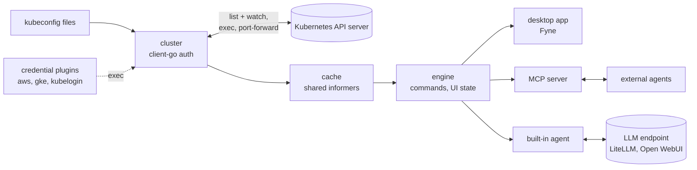

# Cogpit

[](https://github.com/guided-traffic/cogpit/actions)
[](https://github.com/guided-traffic/cogpit)
[](https://goreportcard.com/report/github.com/guided-traffic/cogpit)
[](LICENSE)

Cogpit is a native Kubernetes IDE for the desktop, written in Go: an open-source, clean-room
reimplementation of the current [Lens Desktop](https://lenshq.io/). It runs on your Mac first,
later on Windows and Linux. It reads your kubeconfig files, connects to your clusters with your
own credentials, and gives you the views Lens users know: workloads, logs, shells, YAML editing,
port forwarding and the Helm releases in your clusters. Every view reads from a cache that watches
keep current, so it is fast for you and light on the API server. And agents can drive all of it
over MCP, the UI included. Cogpit is a desktop client: it is never a web UI and is never deployed
into a cluster. **Status: pre-alpha. A local MVP runs on macOS** — 16 built-in views plus one per
custom resource kind, the detail drawer with row menus, YAML editing with diff and dry-run, node
and workload actions, logs, a terminal, a pod shell and MCP control of the UI
([Run the MVP](#run-the-mvp)); it is not a release ([roadmap](ROADMAP.md)).



## ✨ Key Features

Planned. The local MVP already has, in part: the context picker; views from the cache for Nodes,
Namespaces, Events, Pods, Deployments, Daemon Sets, Stateful Sets, Replica Sets, Jobs, Cron Jobs,
Services, Ingresses, Ingress Classes, Config Maps, Persistent Volume Claims, Custom Resource
Definitions and every custom resource kind (following the cluster's definitions live); the detail
drawer and row menus from the command registry; editing YAML with a diff, a server-side dry run
and a resourceVersion precondition; create from templates; Delete for every kind, Restart, Scale,
Cordon, Uncordon, a crash-safe Drain, Trigger, Suspend, Resume and Evict, destructive ones
confirmed; logs with follow, the cluster-bound terminal, the pod shell; and MCP control of all of
it. Progress against Lens is measured in [ROADMAP.md](ROADMAP.md).

- 🖥️ A native macOS app first, Windows and Linux (Ubuntu first) after the macOS beta.
- 🗂️ Every cluster from your kubeconfig files and synced folders, side by side.
- 🧭 Lens's navigator levels: Local Kubeconfigs lists every cluster and the tabs of all of them; › drills into one cluster's resources and its tabs, ‹ goes back up.
- 📌 A hotbar of pinned clusters at the window's edge, in banks of twelve: F1–F12 to switch cluster, ⇧F1–⇧F12 to switch bank.
- ⌨️ A command palette on ⌘⇧P (Ctrl+Shift+P): every action the menus offer, Switch to any view, the hotbar's clusters and banks; ⌘P to search a cluster by name.
- 👋 A welcome page whenever no cluster is open (and from Help › Welcome): your clusters one click away, Add Kubeconfigs, the documentation. Disconnect a cluster, or remove it from Cogpit, which unlinks the kubeconfig file you added and never touches the file.
- ⚙️ Preferences on ⌘, and a cluster's Settings on ⌘⇧,: the theme switched live, the time zone, the editor's and the terminal's settings, a cluster's name and icon (a colour or your image), its terminals' folder and namespace; never written to a kubeconfig.
- 🕐 Every timestamp in your time zone and your region's format, as your Mac's region settings write it ("10.09.2026 17:41:01" in Germany): the drawer, events, logs, notifications, charts.
- 🔐 Your credentials stay yours: kubectl's own authentication code (certificates, tokens, exec plugins for EKS, GKE, AKS); no local proxy, no login.
- ⚡ Cache first: views read from a watch-fed cache; switching back to a view costs no API request.
- 📋 Lens's resource views: workloads, config, network, storage, access control, device resources (with each node's devices in its drawer), custom resources; each searchable by words, with match case or a regular expression.
- 🔏 The certificates in your Secrets decoded in the drawer, PEM or DER, a section per certificate of a chain: subject, issuer, serial, validity (a warning 30 days before it ends), names, key, usages, fingerprint, each field copyable; whether `tls.key` belongs to `tls.crt` and the chain is in order; agents read the same fields, never the PEM text or the private key.
- 📜 Logs with follow, filter, timestamps, the previous container, pod and container selectors, older lines and a jump to a time.
- 💻 Pod shells, attach and a terminal bound to the cluster's context; copy and paste by keys or, if you choose, the right mouse button.
- 🖥️ A node shell, as Lens opens it: a privileged pod in `kube-system` from an image pinned by digest, confirmed every time, deleted when the shell closes.
- 🔐 Create Secret from a dialog, values masked as you type, for you alone: agents can neither create a Secret nor read its values.
- 🧰 The terminal's `kubectl` checked against the cluster: more than one minor version off, or none, and one click downloads the matching release from `dl.k8s.io`, verified against its SHA-256 and the Kubernetes release's signature, for Cogpit's terminals only.
- ✏️ YAML editing with a diff and a server-side dry-run before every apply.
- 🔌 Port forwarding, one click to the browser.
- ⎈ The Helm releases in your clusters (Lens's Helm view), kept in Secrets or ConfigMaps: history, values, upgrade, rollback, through the Helm SDK, no `helm` binary needed.
- 📦 Charts from the repositories in Helm's own `repositories.yaml` (add them with `helm repo add`; Cogpit picks a change up within seconds, logins and CA files included, and never writes the file), installed from a Helm Install tab.
- 🔁 Flux CD: its section in the navigator (Helm releases, Kustomizations, sources, image automation, notifications) with each object's state, revision and message, a dashboard of what is not ready, and Reconcile, Suspend and Resume, on a selection too.
- 📈 CPU and memory from the cluster's metrics-server and its Prometheus: columns in the Pods and Nodes lists, charts with requests and limits in the pod and node drawers, and the cluster Overview: CPU, Memory and Pods of the master or worker nodes over a time range, with the Issues (pods, nodes and workloads in trouble, warning events) below.
- 🛡️ Never surprises a cluster: destructive actions confirm, nothing is installed or written implicitly.
- 🤖 Fully controllable over MCP, the UI included: an agent sees what you see and navigates for you.
- ⌨️ `cogpit-cli`: your contexts and any kind's objects on the command line, read-only, and an MCP stdio bridge you register once.
- 💬 A built-in agent in a chat beside your views, on any OpenAI-compatible endpoint such as LiteLLM or Open WebUI.
- 📦 Installs the Mac way: open the disk image, drag Cogpit into Applications; a Homebrew cask for shell users.
- ⬆️ Updates with one click (Sparkle), verified against a signed update feed.

## 📛 Naming conventions

Names Cogpit generates or expects. Paths are macOS paths; `<user config dir>` is
`~/Library/Application Support`, `<user cache dir>` is `~/Library/Caches`.

| What | Pattern | Example |
|---|---|---|
| Go module | `github.com/guided-traffic/cogpit` | |
| Binaries | `cogpit` (desktop app), `cogpit-cli` (headless CLI and MCP stdio bridge) | |
| App bundle | `Cogpit.app`, bundle id `io.guided-traffic.cogpit` | `bin/Cogpit.app` # example |
| Packages | `internal/<area>` | `internal/cache` # example |
| Command ids | `<kind-or-area>.<action>`, lowerCamelCase segments | `deployment.restart`, `ui.navigate` |
| MCP tool names | the command id with dots replaced by underscores | `deployment_restart`, `ui_navigate` |
| Kind keys (views, `kind` parameters) | the plural resource name for built-in kinds; `<plural>.<group>` for kinds from custom resource definitions ([why](docs/developer/architecture.md#45-kind-keys)) | `pods`, `services`, `gateways.gateway.networking.k8s.io` |
| Page keys (views that are not one kind's list, `ui.openView`'s `view`) | `<navigator group>/<page>` | `cluster/overview`, `workloads/overview`, `flux/dashboard` |
| Annotations the Flux actions set | `reconcile.fluxcd.io/requestedAt` (Reconcile, Resume) and, for a forced Helm release, `reconcile.fluxcd.io/forceAt`: the time in RFC 3339 with nanoseconds, as the flux CLI writes it | `2026-10-13T22:01:02.345678901Z` # example |
| Environment variables | `COGPIT_<NAME>`; today only the test variables `COGPIT_KIND_KUBECONFIG`, `COGPIT_KIND_CONTEXT` and `COGPIT_PNG_DIR` | |
| MCP endpoint | `http://127.0.0.1:<random port>/mcp`, new port on every start | `http://127.0.0.1:59449/mcp` # example |
| MCP bearer token | `<user config dir>/Cogpit/mcp-token`, owner-only (0600, directory 0700), new on every start, removed on exit and when you switch the external MCP server off | |
| MCP endpoint file | `<user config dir>/Cogpit/mcp-endpoint`, beside the token and with its rules: the endpoint's URL, for `cogpit-cli mcp` | `http://127.0.0.1:59449/mcp` # example |
| Audit log | `<user config dir>/Cogpit/audit.log`, owner-only, one JSON line per agent-initiated command; read back newest first in Help › Audit Log and by `audit_list` (its last 4 MiB) | |
| Drain journal | `<user config dir>/Cogpit/drains.json`, owner-only (0600, directory 0700): the drains Cogpit started and has not finished, offered again on the next connect | |
| Hotbar | `<user config dir>/Cogpit/hotbar.json`, owner-only (0600, directory 0700): the banks of pinned clusters by context id; an unreadable one is moved to `hotbar.json.unreadable` at the first change | |
| Helm chart repositories | Helm's own `repositories.yaml`, as the helm CLI resolves it: `$HELM_REPOSITORY_CONFIG`, else `$HELM_CONFIG_HOME/repositories.yaml`, else Helm's folder; read every 2 seconds, never written (add and remove repositories with `helm repo add` and `helm repo remove`, [D-29](docs/developer/decisions.md#d-29-helm-chart-repositories-from-helms-repositoriesyaml)); credentials stay in memory | `~/Library/Preferences/helm/repositories.yaml` # default on macOS |
| Helm repository indexes | `<user cache dir>/Cogpit/helm/indexes/<key>-index.yaml`, owner-only (0600, directory 0700); the key a hash of the repository's name and URL. Nothing goes into Helm's own cache | `~/Library/Caches/Cogpit/helm/indexes/3f2a9c61d0b4e8a7c5f19e2d4b6a8c0e-index.yaml` # example |
| Helm chart objects | kind `helmcharts`, named `<repository>.<chart>` (a repository whose name has a dot is listed as not used) | `bitnami.nginx` # example |
| App log | `<user cache dir>/Cogpit/cogpit.log`, and stderr | |
| Terminal kubeconfig | a temporary file per terminal holding only a context, owner-only, deleted on close ([why](docs/security/credentials.md#the-terminals-kubeconfig)) | |
| Downloaded `kubectl` | `<user config dir>/Cogpit/kubectl/<version>/kubectl` (0755, directories 0700), or the directory for binaries set in Preferences › Kubernetes ([why](docs/developer/decisions.md#d-3-helm-and-kubectl-binaries)) | `~/Library/Application Support/Cogpit/kubectl/1.36.1/kubectl` # example |
| A terminal's own directory | `<temp dir>/cogpit-terminal-<random>/`, owner-only, removed on close, only when Cogpit puts a `kubectl` first: `bin/kubectl` (a link), `zsh/.zshenv` (zsh only) | |
| Node shell pod | `kube-system/cogpit-node-shell-<8 random characters>`, labels `app.kubernetes.io/name=cogpit-node-shell` and `app.kubernetes.io/managed-by=cogpit`, deleted when the shell closes, else ended by its 2-hour deadline ([why](docs/security/privilege-footprint.md#node-shell)) | `kube-system/cogpit-node-shell-k3v9q2mx` # example |
| Node shell dock tab | id `nodeShell-<n>`, title `Node shell: <node>` | `Node shell: worker-1` # example |
| Demo context | `demo` (the synthetic cluster) | |
| Local kind cluster | cluster `cogpit`, context `kind-cogpit`, kubeconfig `.cache/kind/kubeconfig` | |
| Release artifacts (planned) | `Cogpit-<version>-macos-universal.dmg`, `cogpit-cli-<version>-<os>-<arch>.tar.gz` | `Cogpit-0.1.0-macos-universal.dmg` # example |
| Deep links (planned) | `cogpit://` | |

| Identifier | Meaning | Where |
|---|---|---|
| `G<n>` | A gap against Lens or a beyond-Lens target | [docs/parity/gaps.md](docs/parity/gaps.md) |
| `M<n>` | A milestone | [docs/parity/roadmap.md](docs/parity/roadmap.md) |
| `D-<n>` | A decision | [docs/developer/decisions.md](docs/developer/decisions.md) |
| `H-<n>` | An open security gap | [docs/security/](docs/security/README.md) |
| `P<n>` | A performance or API-load budget | [docs/developer/testing.md](docs/developer/testing.md#performance-budgets-proposed-not-measured) |
| `S<n>` | A gate criterion of the Fyne spike | [docs/developer/spike-fyne.md](docs/developer/spike-fyne.md#gate-criteria) |

## 📚 Documentation

| Document | For |
|---|---|
| [ROADMAP.md](ROADMAP.md) | One page: stage, numbers, what's next |
| [AGENTS.md](AGENTS.md) | Contributors and agents: the rules, how to pick work |
| [docs/parity/](docs/parity/README.md) | Where Cogpit stands against Lens: assessment, gaps, roadmap, checklists for [interface](docs/parity/ui-parity.md), [resources](docs/parity/resource-parity.md), [platforms](docs/parity/platform-parity.md) and [beyond Lens](docs/parity/beyond-lens.md) |
| [docs/developer/](docs/developer/README.md) | Architecture, conventions, extending, testing, releasing, [decisions](docs/developer/decisions.md), the [Fyne spike](docs/developer/spike-fyne.md) |
| [docs/security/](docs/security/README.md) | Trust boundaries, credentials, privilege footprint, agents and MCP, updates |
| [SECURITY.md](SECURITY.md) | Reporting a vulnerability |
| [ATTRIBUTION.md](ATTRIBUTION.md) | Third-party material |
| [Lens documentation](https://docs.lenshq.io/) | The target's behaviour |
| [client-go](https://github.com/kubernetes/client-go), [Fyne](https://fyne.io/), [MCP Go SDK](https://github.com/modelcontextprotocol/go-sdk) | The main building blocks |

## 🚀 TL;DR fast start

### Download a release

Every [release](https://github.com/guided-traffic/cogpit/releases) since v0.1.0 (2026-10-13)
carries `Cogpit_<version>_darwin_arm64.zip` (the app for Apple silicon), `cogpit-cli` for Linux,
macOS and Windows on amd64 and arm64, and `SHA256SUMS`. **They are unsigned:** no Developer ID,
not notarized, so macOS blocks the app's first start until you allow it under System Settings ›
Privacy & Security › Open Anyway ([updates](docs/security/updates.md#what-a-release-holds-today)).

```sh
shasum -a 256 -c SHA256SUMS --ignore-missing      # sha256sum on Linux
tar -xzf cogpit-cli_<version>_darwin_arm64.tar.gz && ./cogpit-cli_<version>_darwin_arm64/cogpit-cli --version
```

### Run the MVP

The MVP is a local build for macOS (tested on Apple silicon, macOS 26). It needs Go (1.26 or
later; the build fetches Go 1.27.2 itself), the Xcode Command Line Tools (Fyne uses cgo), and for
the kind cluster Docker, `kind` and `kubectl`.

```sh
git clone https://github.com/guided-traffic/Cogpit.git
cd Cogpit

make run-demo                 # synthetic cluster: 10,000 pods, 1,000 watch events per second

make kind-up                  # a kind cluster "cogpit" with its own kubeconfig (.cache/kind/kubeconfig)
make run                      # Cogpit connected to it; make kind-down removes it

make build && bin/cogpit      # your own clusters: syncs ~/.kube (config included) and offers the files $KUBECONFIG names, each file on its own
make app                      # bin/Cogpit.app (ad-hoc signed), starts by double-click
```

`make kind-up` seeds the namespace `cogpit-demo` ([hack/kind](hack/kind/README.md)): deployments
`web` and `api`, a crash-looping pod, a completed job, a `toolbox` pod with a shell, and the Service
`web` with the ClusterIP `10.96.100.100`. Nothing writes `~/.kube/config`; `make run` lists your `~/.kube` contexts too (Kubeconfig Sources removes the folder from the list, never from disk).

**Drive it with an agent.** At start, Cogpit prints a ready-to-paste command:

```sh
claude mcp remove --scope user cogpit >/dev/null 2>&1; claude mcp add --scope user --transport http cogpit http://127.0.0.1:<port>/mcp --header "Authorization: Bearer <token>"
```

Run it, then ask Claude Code "show me the Service with ClusterIP 10.96.100.100": Cogpit opens
Services, selects `web` and opens its drawer. Port and token change on every start, so repeat the
command after a restart, or register the stdio bridge once instead:
`claude mcp add --scope user cogpit -- "$PWD/bin/cogpit-cli" mcp` # example (it reads the
current port and token itself). Agents may read and navigate freely; Restart, Delete and the pod shell
wait for your confirmation in Cogpit's window ([agents and MCP](docs/security/agents-and-mcp.md)).

**Verify.** `make test-unit-race` runs every test without a cluster; with the kind cluster up,
`make test-kind` also runs the cluster tests (views, logs, pod shell, `kubectl` in the terminal).

**Not built yet (2026-10-13):** Windows and Linux packages, signed releases (the releases are unsigned) and updates, the built-in agent chat; what exists and
what is missing, row by row: [docs/parity](docs/parity/README.md).

<details>
<summary>Clean up</summary>

```sh
make kind-down     # deletes the kind cluster and its kubeconfig file
make clean         # removes bin/ and dist/
rm -rf ~/Library/Caches/Cogpit "~/Library/Application Support/Cogpit"   # logs, audit log, token, downloaded kubectl releases
```

</details>

## 📖 Full reference

### `cogpit` flags

| Flag | Default | Meaning |
|---|---|---|
| `--kubeconfig <files>` | empty: the files `$KUBECONFIG` lists # default | kubeconfig files, separated by `:`, offered as sources of their own for this run, each read alone and removable until the next start; `~/.kube` is synced either way (a bare `--context` name resolves to the one file that defines it) |
| `--context <name>` | empty: show the context picker # default | connect to this context at start |
| `--demo` | `false` # default | connect to the synthetic demo cluster |
| `--demo-pods <n>` | `10000` # default | pods in the demo cluster |
| `--demo-events <n>` | `1000` # default | watch events per second in the demo cluster |
| `--mcp-addr <addr>` | `127.0.0.1:0` # default | MCP listen address; anything but a loopback address is refused |
| `--no-mcp` | `false` # default | do not start the external MCP server; without it, click the MCP item in the status bar to switch the server off and on (the choice is remembered; `--no-mcp` wins over it) |
| `--perf <duration>` | `0` # default | measure main-loop latency while auto-scrolling the table, print it as JSON and quit |
| `--theme <mode>` | `dark` # example | `dark` (Solarized Dark), `light` (Solarized Light) or `system`, for this run; without it the theme of Preferences › App (⌘,) applies, Dark until changed |
| `-v` | `false` # default | debug logging |

Security note on `--mcp-addr`: the server checks `Host`, `Origin` and the bearer token, and binds
loopback addresses only, because any reachable listener would let others drive Cogpit with your
cluster identities.

### `cogpit-cli`

The headless command-line tool (pure Go, no window). It offers the same contexts as the app, from
the same kubeconfig sources (`~/.kube`, the files `--kubeconfig` or `$KUBECONFIG` names, the files
and sync folders added in Cogpit), and runs a context's credential plugin only once you allowed it
in Cogpit's window; it never asks itself and never writes Cogpit's sources or approvals. Exit
codes: `0` done, `1` the command failed, `2` the command line is wrong. `cogpit-cli <command>
--help` prints a command's flags.

| Command | Flags | What it does |
|---|---|---|
| `cogpit-cli contexts` | `--kubeconfig <files>` (empty: the files `$KUBECONFIG` lists # default), `-o table` # default (`json`, `yaml`), `-v` (`false` # default) | lists every context as `<context> [<file>]`, with its namespace, server and whether its login (a credential plugin, or a token file outside its folder) is `approved`, `required` or `changed`, and `not checked` under CERTIFICATE for a context whose cluster sets `insecure-skip-tls-verify` (the last column; Cogpit's default); `json` and `yaml` are the `cluster_contexts` tool's result (`insecure: true`); reads the kubeconfig files only |
| `cogpit-cli get <kind> [name]` | `--context <context>` (required; an id as `contexts` lists it, a context name only one file defines, or `demo`), `-n`/`--namespace <ns,...>` (empty: every namespace, for a named object the context's namespace # default), `-o table` # default (`json`, `yaml`), `--filter <text>` (empty # default), `--timeout 1m` # default, `--kubeconfig <files>`, `-v` | connects through a headless engine, waits for the cache's first list of the kind and prints it as Cogpit's view does (its columns, those empty in every row left out), then exits; `json` and `yaml` print the `resources_list` result for a list (at most 1,000 rows; stderr says when there are more) and the object's manifest for a named object (managed fields dropped, Secret values redacted). `<kind>` is a kind key (`pods`, `certificates.cert-manager.io`), or a Kubernetes kind or view title that names one kind (`Pod`) |
| `cogpit-cli mcp` | `--headless` (`false` # default), `--kubeconfig <files>` (the headless engine only), `-v` | serves Cogpit's MCP tools over stdin and stdout for agents that speak only stdio: with Cogpit running, every call is forwarded to it (its confirmations and audit log apply; a restart of Cogpit is followed); without it, or with `--headless`, an engine of its own serves them, and what needs your confirmation is refused. stdout carries the protocol only; logs go to stderr |
| `cogpit-cli version` | – | prints the version, the Go version and the platform (`--version` too) |

```sh
cogpit-cli contexts                                         # every context Cogpit offers
cogpit-cli get pods -n kube-system --kubeconfig .cache/kind/kubeconfig --context kind-cogpit   # example: kind's system pods
cogpit-cli get deployments web -n cogpit-demo -o yaml --kubeconfig .cache/kind/kubeconfig --context kind-cogpit   # example: one manifest
cogpit-cli get services --context demo                      # the synthetic demo cluster
```

Security note on `mcp`: the bridge sends the token from Cogpit's token file only to the loopback
URL in `mcp-endpoint`, follows no redirect and uses no proxy. Switching the MCP server off in the
status bar stops a bridge that forwards to the app, but not one that serves its own engine, which
reads clusters and refuses every write ([H-28](docs/security/agents-and-mcp.md#h-28-the-status-bars-switch-does-not-reach-a-headless-bridge)).

Security note on `get`: it only reads (`resources_list` and `object_get` through the cache, origin
CLI), prints a Secret's key names and sizes but never a value, and refuses a context whose
credential plugin you have not allowed in Cogpit's window before the plugin runs. Like the app's
views it watches a kind in every namespace and filters by `-n` afterwards, so a user who may list
a kind only in some namespaces gets the API server's refusal.

Security note on `contexts`: context names, file names and every other text from a kubeconfig or a
cluster are escaped before they reach your terminal (`\u001b` for an escape character), since
anyone who can drop a file into a sync folder chooses them. Without a configuration directory
(no `$HOME`) the CLI refuses to connect rather than merging the files as kubectl does, which
would run their plugins unasked.

### Preferences › Kubernetes: `kubectl` for terminals

Kept in `<user config dir>/Cogpit/preferences.json` (owner-only), set on the Preferences page (⌘,)
or with `preferences_set`. When a terminal opens, its `kubectl` is compared with the cluster's
version; more than one minor version off, or none, and the terminal offers the matching release
([D-3](docs/developer/decisions.md#d-3-helm-and-kubectl-binaries)).

```json
{
  "kubectlDownload": true,
  "kubectlMirror": "",
  "kubectlDir": "",
  "kubectlPath": ""
}
```

| Field | Default | Meaning |
|---|---|---|
| `kubectlDownload` | `true` # default | offer the matching release in a terminal whose `kubectl` does not suit the cluster; off, the terminal only says so. The download itself always waits for your click |
| `kubectlMirror` | `""`: `https://dl.k8s.io/release` # default | the https base URL under which `v<version>/bin/<os>/<arch>/kubectl` and its `.sha256`, `.sig` and `.cert` lie, such as `https://mirror.example.com/kubernetes/kubectl` # example |
| `kubectlDir` | `""`: `<user config dir>/Cogpit/kubectl` # default | the directory for binaries, an absolute path; releases go into `<dir>/<version>/kubectl` |
| `kubectlPath` | `""`: the first `kubectl` on `PATH` # default | the `kubectl` your terminals run, an absolute path; Cogpit checks it against the cluster as it would check `PATH`'s and puts it first on the terminal's `PATH` |

Security note: the last three decide which program your terminals run as `kubectl`, so only you, in
Cogpit's window, can set them, and only you can start a download; agents and `cogpit-cli` are
refused. A mirror needs no trust of its own: every download is checked against the Kubernetes
release's sigstore signature (its certificate chained to sigstore's authority, which Cogpit embeds,
for the release's identity), and refused when the mirror serves no `.sig` or `.cert`. The download
goes through the HTTP proxy for non-cluster traffic (`httpProxy`, Preferences › Proxy) when one is set. sigstore's
transparency log is not consulted ([H-35](docs/security/trust-boundaries.md#h-35-kubectls-signature-is-checked-without-sigstores-transparency-log)).

### Commands and MCP tools

Every command is an MCP tool (dots become underscores). `?` marks optional parameters; `ref` is
`{context?, kind, namespace?, name}`. Danger decides confirmation: `destructive` always asks in
Cogpit's window, `mutating` asks when an agent calls it, `read` and `ui` never ask
([D-2](docs/developer/decisions.md#d-2-agent-interface-scope)). The table is generated from the
registry with `go run ./hack/readmecmds`.

<details>
<summary>All 163 commands</summary>

| Command | MCP tool | Danger | Parameters | What it does |
|---|---|---|---|---|
| `application.logs` | `application_logs` | read | `ref` | Opens the logs of an application (applications view): a workload_logs dock tab for each of its Deployments, Stateful Sets, Daemon Sets and Jobs, at most 8, each following every container of the workload's pods |
| `audit.list` | `audit_list` | read | `limit`?, `offset`?, `origin`? | Reads Cogpit's audit log, newest first: one entry per command an agent dispatched (external agents, the built-in agent; and the few switches the user made in the window that are no command), with its time, origin, command, the context it ran in, its phase (requested before a write runs, done with its outcome), ok or the error, the objects its parameters name and the parameters as logged (Secret values, Helm values and proxy passwords never are) |
| `audit.open` | `audit_open` | ui | `origin`? | Opens the Audit Log dock tab, or activates it: the audit log's entries newest first (time, origin, command, objects, outcome), read-only, filtered by origin (origin; empty: all), as Help › Audit Log does |
| `cluster.connect` | `cluster_connect` | ui | `context` | Connects to a kubeconfig context (or the demo cluster), replacing the current connection, and shows its most recently used tab, or else its Pods view in the preview tab; the other clusters' tabs stay |
| `cluster.connectLog` | `cluster_connectLog` | read | `context` | Returns the log of the last attempt to connect to a context this session (and of a connection Cogpit closed because its kubeconfig file went away): lines with a time, a level (INFO or ERROR) and a text |
| `cluster.contexts` | `cluster_contexts` | read |  | Lists the kubeconfig contexts Cogpit can connect to (name, cluster, user, default namespace, server, whether it is the kubeconfig's current context) and the synthetic demo cluster if offered |
| `cluster.disconnect` | `cluster_disconnect` | ui |  | Closes Cogpit's connection to the connected cluster, or ends a connect under way |
| `cluster.links` | `cluster_links` | read | `context`? | Tells where Cogpit reads each context from: its kubeconfig source (a file the user added, a synced folder such as the default ~/.kube, or a file $KUBECONFIG names for this run), the file's path, every context that file defines, and whether cluster_remove can unlink it (removable) or why not (reason) |
| `cluster.overview` | `cluster_overview` | read | `namespaces`?, `noIssues`?, `series`? | Reads the cluster Overview: the node groups (master: control-plane nodes; worker: the others), the group and time range the charts show (ui_setOverviewNodes, ui_setOverviewRange), the charts CPU (cores), Memory (bytes) and Pods for that group with their current usage, requests and limits (sums over the pods that have not finished on those nodes), allocatable capacity and capacity, the metrics providers' state, and the Issues: pods with a warning, nodes not Ready or under pressure, Deployments, Stateful Sets and Daemon Sets short of ready pods, and warning events of the last hour, each with its object (ref), kind, message and since when |
| `cluster.prometheus` | `cluster_prometheus` | read |  | Returns which Prometheus the connected cluster's metrics come from: auto (found among the cluster's Services by its well-known names) or the service address namespace/service:port and path prefix the user set, and whether the setting is kept in Cogpit's preferences |
| `cluster.refreshAccess` | `cluster_refreshAccess` | read |  | Asks the API server again what the connected user may do (SelfSubjectRulesReview per namespace, SelfSubjectAccessReview where rules cannot answer) and drops the answers Cogpit kept since connecting: use it after the user's roles changed |
| `cluster.remove` | `cluster_remove` | ui | `context` | Removes a cluster from Cogpit by removing Cogpit's link to the kubeconfig file the user added for it: every context of that file is no longer offered and its tabs close, the login programs allowed for it are forgotten and a connection made from it is closed |
| `cluster.setPrometheus` | `cluster_setPrometheus` | ui | `address`?, `prefix`? | Sets which Prometheus the connected cluster's metrics come from, as Lens's cluster settings do: a service address namespace/service:port and an optional path prefix, read through the API server's service proxy, or auto to find it by its well-known service names again |
| `cluster.settings.get` | `cluster_settings_get` | read | `context`? | Returns a context's settings in Cogpit, as its Settings page shows them: the name it shows (the display name set, else the context's name), its icon colour or uploaded image's format, the kubeconfig file it comes from, its terminals' working directory and kubectl namespace (empty: $HOME and the filter's or the context's namespace), the metrics the window hides (hiddenMetrics; empty: all visible), the accessible namespaces named for a user who may not list namespaces (accessibleNamespaces), the node shells' image and pull secret (nodeShellImage, empty: nodeShellDefaultImage; nodeShellPullSecret), whether it is the connected cluster, whether the user allowed agents' changes without asking (agentWrites), and whether the settings are kept |
| `cluster.settings.open` | `cluster_settings_open` | ui | `context`?, `section`? | Opens a context's Settings page in Cogpit's window, as ⌘⇧, (Ctrl+Shift+,) does for the connected cluster, at a section: general (name, icon, kubeconfig), proxy, terminal, namespaces (the accessible namespaces), metrics (the Prometheus, hidden metrics), nodeShell or agents |
| `cluster.settings.resetIcon` | `cluster_settings_resetIcon` | ui | `context`? | Gives a context its default icon back: its initials in the accent colour, without an uploaded image or an icon colour |
| `cluster.settings.set` | `cluster_settings_set` | ui | `accessibleNamespaces`?, `context`?, `hiddenMetrics`?, `iconColor`?, `name`?, `proxy`?, `terminalDir`?, `terminalNamespace`? | Changes some of a context's settings in Cogpit, as its Settings page does; the fields left out stay as they are, an empty value restores the default |
| `cluster.settings.setAgentWrites` | `cluster_settings_setAgentWrites` | ui | `allowed`, `context`? | Allows or forbids, for one context, agents' mutating commands without the user's acceptance, as the Agents section of its Settings page does; destructive commands always ask |
| `cluster.settings.setNodeShell` | `cluster_settings_setNodeShell` | ui | `context`?, `image`?, `imagePullSecret`? | Sets a context's node shell image and image pull secret (in kube-system), as Cluster Settings › Node Shell does; a field left out stays, an empty value restores the default (Cogpit's image pinned by digest, no pull secret) |
| `cluster.settings.uploadIcon` | `cluster_settings_uploadIcon` | ui | `context`?, `path` | Makes an image file the user picked a context's icon (it replaces the icon colour): a PNG or JPEG, kept as a PNG of at most 256 pixels a side, or an SVG without scripts or outside references, at most 1 MiB |
| `clusterRole.create` | `clusterRole_create` | mutating | `name`, `rules`? | Creates a ClusterRole with the given rules (API groups and resources, or non-resource URLs) after a server-side dry run; the API server refuses rules that grant more than the user holds unless the user may escalate roles |
| `clusterRoleBinding.create` | `clusterRoleBinding_create` | destructive | `clusterRole`, `name`, `subjects` | Creates a ClusterRoleBinding that grants a ClusterRole in every namespace and on cluster-scoped resources to users, groups and service accounts, after a server-side dry run; the API server refuses it unless the user holds the role's permissions or may bind it |
| `cronjob.resume` | `cronjob_resume` | mutating | `ref` | Resumes a suspended cron job: sets spec.suspend to false, so that it runs on its schedule again |
| `cronjob.suspend` | `cronjob_suspend` | mutating | `ref` | Suspends a cron job: sets spec.suspend to true, so that it starts no Jobs on its schedule; running Jobs go on |
| `cronjob.trigger` | `cronjob_trigger` | mutating | `ref` | Runs a cron job now, as kubectl create job --from=cronjob/<name> does: creates a Job from the cron job's job template, with its labels and annotations, the annotation cronjob.kubernetes.io/instantiate=manual and the cron job as its controller, named <cronjob>-manual-<5 random characters> (within 63 characters) |
| `daemonset.restart` | `daemonset_restart` | destructive | `ref` | Restarts a daemon set the way kubectl rollout restart does: it sets the pod template's kubectl.kubernetes.io/restartedAt annotation, and the controller replaces every pod by its update strategy (with OnDelete, only as pods are deleted) |
| `deployment.restart` | `deployment_restart` | destructive | `ref` | Restarts a Deployment the way kubectl rollout restart does: it sets the pod template's restartedAt annotation and the controller replaces every pod |
| `deployment.scale` | `deployment_scale` | mutating (destructive for some calls) | `ref`, `replicas`? | Sets a deployment's replica count, as kubectl scale does: a patch of spec.replicas on its scale subresource |
| `diagnostics.get` | `diagnostics_get` | read |  | Returns what Cogpit asked of the connected cluster and holds of it, as the Diagnostics tab shows it: the API requests since connecting, by verb and by verb and resource (list, watch, get, ...; watches included), each watch (informer) with its scope, state (open: a view or lookup holds it; warm: kept a while after its last user; covered: served by another watch), objects, events and errors, the objects per kind, and the table snapshots built |
| `diagnostics.open` | `diagnostics_open` | ui |  | Opens the Diagnostics dock tab, or activates it: the connected cluster's API requests by verb and resource, its watches and the objects per kind, kept current while it is open, as Help › Diagnostics does |
| `dock.activate` | `dock_activate` | ui | `id` | Shows a dock tab |
| `dock.close` | `dock_close` | ui | `id` | Closes a dock tab and ends its stream or shell |
| `editor.diff` | `editor_diff` | read | `context`?, `id`, `yaml`? | Returns the line diff of an Edit tab's text (or of yaml) against the object as Cogpit's cache holds it now: lines with op "-" (removed), "+" (added) or "=" (context), with line numbers |
| `editor.discardDraft` | `editor_discardDraft` | ui | `id` | Deletes a draft from editor_drafts: its unsaved text is gone for good |
| `editor.drafts` | `editor_drafts` | read | `all`? | Lists the drafts of unsaved editor text Cogpit kept from Edit and Create resource tabs that a crash or a quit ended (the connected context's; all: every context's), oldest first: the tab's type, title, object and the version its text is based on, when it was kept, its size; never the text. editor_restoreDraft opens the tab with the text again (editor_get then reads it), editor_discardDraft deletes it |
| `editor.get` | `editor_get` | read | `id` | Returns an editor tab's text (what the user has typed so far) and its revision; for an Edit tab also the resourceVersion the edit is based on, the one Cogpit's cache holds now, and whether they differ (stale: an apply would be refused with a conflict) or the object is gone (missing); for a Helm Upgrade tab the release revision its values are based on |
| `editor.restoreDraft` | `editor_restoreDraft` | ui | `id` | Opens the tab of a draft from editor_drafts again with its text, on the draft's context, which must be connected: a Create resource tab, or an Edit tab on the object based on the version the draft was based on, so that an apply after a change on the cluster is refused with a conflict first |
| `editor.revert` | `editor_revert` | ui | `id` | Replaces an Edit tab's text with the object as Cogpit's cache holds it now and bases the edit on that version, as a freshly opened tab is. changed says whether the text held unsaved changes; editor_undoRevert puts them back while the text is unchanged since |
| `editor.setText` | `editor_setText` | ui | `id`, `yaml` | Replaces an editor tab's text, as typing does; the tab shows it unless the user has unsaved typing of their own |
| `editor.undoRevert` | `editor_undoRevert` | ui | `id` | Puts back the text an Edit tab's last editor_revert replaced, based on the version it was based on, while the tab still holds what the revert left (editor_get's canUndoRevert) |
| `flux.dashboard` | `flux_dashboard` | read | `namespaces`?, `table`? | Reads the Flux dashboard: for each Flux kind the cluster serves (Helm releases, Kustomizations, image repositories, policies and update automations, alerts, providers, receivers, Git, OCI and Helm repositories, buckets, external artifacts) the number of objects in the selected namespaces by state: ready, notReady (Ready False or Stalled), reconciling, suspended, unknown (no Ready condition yet); with table, also every object that is not ready, with its message |
| `flux.reconcile` | `flux_reconcile` | mutating | `force`?, `ref` | Asks Flux to reconcile one object now, as flux reconcile does without --with-source: sets the annotation reconcile.fluxcd.io/requestedAt to the current time (with force, a Helm release also gets reconcile.fluxcd.io/forceAt) |
| `flux.reconcileMany` | `flux_reconcileMany` | mutating | `force`?, `refs` | Does what flux_reconcile does for several Flux objects at once, as the table's selection menu does: it acts on the selected objects it applies to, one after the other, each bound to its UID, and skips the others |
| `flux.resume` | `flux_resume` | mutating | `ref` | Resumes a suspended Flux object, as flux resume does: sets spec.suspend to false and requests a reconcile (reconcile.fluxcd.io/requestedAt) |
| `flux.resumeMany` | `flux_resumeMany` | mutating | `refs` | Does what flux_resume does for several Flux objects at once, as the table's selection menu does: it acts on the selected objects it applies to, one after the other, each bound to its UID, and skips the others |
| `flux.suspend` | `flux_suspend` | mutating | `ref` | Suspends one Flux object, as flux suspend does: sets spec.suspend to true, so that its controller leaves it alone until it is resumed |
| `flux.suspendMany` | `flux_suspendMany` | mutating | `refs` | Does what flux_suspend does for several Flux objects at once, as the table's selection menu does: it acts on the selected objects it applies to, one after the other, each bound to its UID, and skips the others |
| `helm.chart.install` | `helm_chart_install` | mutating | `chart`?, `createNamespace`?, `name`, `namespace`, `repository`?, `tab`?, `textRevision`?, `values`?, `version`? | Installs a chart from a repository of Helm's repositories file as a new release, as helm install does with its defaults (hooks waited for, 5 minutes; no --create-namespace unless createNamespace): the chart and version of a Helm Install tab with its values (tab), or a chart, version and values given here |
| `helm.chart.installTab` | `helm_chart_installTab` | ui | `ref`, `version`? | Opens a Helm Install dock tab on a chart of a repository of Helm's repositories file, or activates the one already open on it (at another version: loads that version): Cogpit downloads the chart's archive (checked against the index's digest when it lists one) and shows its values.yaml in an editor, with the versions the repository lists |
| `helm.chart.preview` | `helm_chart_preview` | read | `chart`?, `createNamespace`?, `name`, `namespace`, `repository`?, `tab`?, `textRevision`?, `values`?, `version`? | Renders a chart install without changing anything and returns the objects, hooks and custom resource definitions it would create, by kind, namespace and name, never their content |
| `helm.dismissOperation` | `helm_dismissOperation` | ui | `ref` | Forgets an unfinished Helm action from helm_pendingOperations without changing the cluster: the release stays as it is (pending-rollback or uninstalling, unless someone changed it) |
| `helm.pendingOperations` | `helm_pendingOperations` | read | `all`? | Lists the Helm rollbacks, uninstalls, upgrades and installs Cogpit started on the connected context (all: on every context) that did not finish: context, namespace, release, action, the target revision of a rollback, the revision an upgrade started from (fromRevision) and its chart (an install's as <repository>/<chart>), when and by whom started, status (running in this Cogpit or, with elsewhere and its owner's process, in another one, interrupted by an earlier run of Cogpit ending, or failed with its error) and the release's status from the cache (pending-install, pending-rollback, pending-upgrade, uninstalling, deployed, missing, unknown) |
| `helm.release.history` | `helm_release_history` | read | `ref` | Returns a release's revisions from Cogpit's cache, newest first (as many as Helm keeps, ten by default): each revision's chart and version, app version, status, when it was deployed and its description, with the release's newest revision and status |
| `helm.release.rollback` | `helm_release_rollback` | destructive | `ref`, `revision` | Rolls a Helm release back to an earlier revision of its history, as helm rollback does with its defaults (hooks waited for, ten revisions kept): a new revision with that revision's chart, values and manifest, and the release's objects changed to it |
| `helm.release.uninstall` | `helm_release_uninstall` | destructive | `ref` | Uninstalls a Helm release as helm uninstall does with its defaults: runs its hooks, deletes every object of the release and its history |
| `helm.release.upgrade` | `helm_release_upgrade` | mutating | `ref`, `repository`?, `revision`?, `tab`?, `textRevision`?, `values`?, `version`? | Upgrades a Helm release as helm upgrade does with its defaults (hooks waited for, ten revisions kept), with new user-supplied values, which replace the old ones whole: the values of a Helm Upgrade tab (tab), or values given here with the revision they are based on |
| `helm.release.upgradeTab` | `helm_release_upgradeTab` | ui | `ref`, `repository`?, `version`? | Opens a release's Helm Upgrade dock tab, or activates the one already open on it: the release's chart, the version the upgrade installs and the versions to choose from, and its user-supplied values in an editor, read from Cogpit's cache |
| `helm.release.values` | `helm_release_values` | read | `all`?, `ref` | Returns a release's values from Cogpit's cache, the newest revision's: the user-supplied ones, or all of them with the chart's defaults (all), with the revision and chart they are of |
| `helm.repo.list` | `helm_repo_list` | read |  | Lists the Helm chart repositories of Helm's own repositories.yaml (the helm CLI adds and removes them; Cogpit only reads the file, within 5 seconds of a change), in its order: name, URL without a user or password, whether credentials are present (never a credential), TLS facts (CA file, client certificate, insecure, plain http), how many charts the index lists, when it was downloaded, the last error or why Cogpit does not use an entry; with the file's path and status (ok, missing, error: the last good list kept) |
| `helm.repo.update` | `helm_repo_update` | ui | `names`? | Downloads the index of every Helm repository of Helm's repositories.yaml (or of those named) again into Cogpit's own cache, one after the other, as helm repo update does, with the credentials Helm's file holds; nothing is written into Helm's file or folders |
| `hotbar.addCluster` | `hotbar_addCluster` | ui | `bank`?, `context`? | Pins a cluster to the hotbar: a tile for the context at the end of a bank, which F1–F12 open by its place |
| `hotbar.createBank` | `hotbar_createBank` | ui | `name`? | Adds an empty bank after the others and shows it; the hotbar holds at most 12 banks, the ones ⇧F1–⇧F12 reach |
| `hotbar.list` | `hotbar_list` | read |  | Returns the hotbar, the bar of pinned clusters at the left edge of Cogpit's window: its banks (numbered from 1, as the switcher shows them) with their names and tiles, top to bottom, and the bank shown now (current) |
| `hotbar.moveCluster` | `hotbar_moveCluster` | ui | `bank`?, `context`, `position` | Moves a tile to another place in its bank (from 1, the top), which changes the F-key that opens it; the tiles between move one place |
| `hotbar.openCluster` | `hotbar_openCluster` | ui | `bank`?, `slot` | Opens the cluster of a hotbar tile, as clicking it or pressing its F-key does (F1 the top tile of the bank shown): connects to its context and shows its last used tab or its Pods view, replacing the current connection, exactly as cluster_connect does; a tile of the cluster connected already changes nothing |
| `hotbar.removeBank` | `hotbar_removeBank` | ui | `bank`? | Removes a bank of the hotbar with its tiles; the banks after it move up one number, and the hotbar keeps at least one bank |
| `hotbar.removeCluster` | `hotbar_removeCluster` | ui | `bank`?, `context`? | Unpins a cluster: removes the context's tile from a bank; the tiles below it move up one place |
| `hotbar.renameBank` | `hotbar_renameBank` | ui | `bank`?, `name` | Renames a bank of the hotbar; the switcher shows the name as its tooltip |
| `hotbar.switchBank` | `hotbar_switchBank` | ui | `bank` | Shows another bank of the hotbar, as the switcher's arrows or ⇧F1–⇧F12 do; F1–F12 then open that bank's clusters |
| `kinds.list` | `kinds_list` | read |  | Lists the kinds the connected cluster serves, as Cogpit shows them: kind key (what other tools take as kind), title, Kubernetes kind, group, version, whether it is namespaced, its table columns, and the fields resources_find can search by |
| `kubeconfig.addFile` | `kubeconfig_addFile` | ui | `path` | Adds a kubeconfig file the user picked as a source: its contexts become available as "<context> [<file name>]", read from that file alone, and follow its changes |
| `kubeconfig.addFolder` | `kubeconfig_addFolder` | ui | `path` | Adds a sync folder: every kubeconfig file in it (not in its subfolders) becomes available as "<context> [<folder>/<file>]", and files that appear in it or leave it later are picked up or dropped |
| `kubeconfig.approveExec` | `kubeconfig_approveExec` | ui | `approvals` | Records that the user allows the credential plugins of the listed kubeconfig source contexts to run, exactly as shown (each context's fingerprint binds the command, its arguments, its environment, the server and how it is trusted); a later change asks again |
| `kubeconfig.execPlugin` | `kubeconfig_execPlugin` | read | `context` | Describes how a kubeconfig source's context logs in when that needs the user's approval: the credential plugin (users[].user.exec) it runs and a token file (users[].user.tokenFile) outside the kubeconfig's folder |
| `kubeconfig.pendingApprovals` | `kubeconfig_pendingApprovals` | read | `context`? | Lists the logins of kubeconfig source contexts that wait for the user's approval, grouped by kubeconfig file and plugin: contexts of one file that run the same program the same way (command, arguments, environment, API version, interactive mode) or read the same token file are one group, asked about once |
| `kubeconfig.remove` | `kubeconfig_remove` | ui | `source` | Removes a kubeconfig source, which is Cogpit's link to a file or folder and nothing else: its contexts are no longer offered and their tabs close, the credential plugins allowed for its files are forgotten, and an open connection made from one of its files is closed |
| `kubeconfig.sources` | `kubeconfig_sources` | read |  | Lists the kubeconfig sources: the user's ~/.kube sync folder (default), the files named in $KUBECONFIG or --kubeconfig (session: removable for this run only), and the files and folders the user added, each with its id, kind, path, the files read from it, how many contexts it offers and why it cannot be read |
| `kubectl.download` | `kubectl_download` | ui | `tab` | Downloads the kubectl release a terminal tab offers (the cluster's version, when the kubectl the terminal finds is more than one minor version away or missing) from dl.k8s.io or the mirror set in Preferences, verifies it against the published SHA-256 and the Kubernetes release's signature, and keeps it in the directory for binaries; terminals opened afterwards find it first on PATH |
| `logs.controller` | `logs_controller` | read | `id` | Turns a pod's logs tab into the logs of the resource that controls the pod (its Deployment, Daemon Set, Stateful Set, Replica Set or Job; a Deployment's pods through their replica set), as workload_logs shows them: every pod's containers, each line with its pod and container |
| `logs.jumpTo` | `logs_jumpTo` | read | `id`, `time` | Scrolls a logs tab to the first line written at or after a time, as the tab's time field does, and stops it following |
| `logs.loadOlder` | `logs_loadOlder` | read | `id` | Loads the lines before the oldest a logs tab holds, as selecting the tab's "Load older lines" row does |
| `logs.setOptions` | `logs_setOptions` | ui | `filter`?, `id`, `previous`?, `resourceNames`?, `search`?, `timestamps`?, `wrap`? | Changes a logs tab's options, as the tab's toolbar does: previous (the previous terminated container's log), timestamps, resourceNames, wrap, search and filter |
| `logs.setSource` | `logs_setSource` | read | `container`?, `id`, `pod`? | Changes which pod and container a logs tab shows, as the tab's selectors do (choices: logs_sources) |
| `logs.sources` | `logs_sources` | read | `id` | Lists what a logs tab's pod and container selectors offer, from Cogpit's cache: for the logs of a controlling resource (allPods true) its pods, and the containers of the pod the tab shows or of every pod; for a pod's tab the pods of the resource that controls it (the pod alone if none does) and the pod's containers |
| `metrics.get` | `metrics_get` | read | `kind`, `limit`?, `name`?, `namespace`? | Reads the current CPU (millicores) and memory (bytes) usage of a pod, of the pods of a namespace or of all namespaces, of a node, or of all nodes, from the cluster's Kubernetes Metrics Server (metrics.k8s.io), or from its Prometheus (read through the API server's service proxy) when the Metrics Server fails or is missing; the result's source says which, and its providers say what Cogpit knows of each (answering or not, the last good answer, the last failure's class, what it serves) |
| `namespace.create` | `namespace_create` | mutating | `name` | Creates a Namespace after a server-side dry run |
| `node.cordon` | `node_cordon` | mutating | `ref` | Cordons a node as kubectl cordon does: sets spec.unschedulable, so that no new pods are scheduled on it; running pods stay |
| `node.dismissDrain` | `node_dismissDrain` | ui | `ref` | Forgets an unfinished drain from node_pendingDrains without changing the cluster: the node stays as it is (cordoned and partly drained, unless someone changed it) |
| `node.drain` | `node_drain` | destructive | `deleteEmptyDirData`?, `force`?, `gracePeriodSeconds`?, `ignoreDaemonSets`?, `ref`, `timeoutSeconds`? | Drains a node as kubectl drain does: cordons it, then evicts every pod on it through the eviction API, which honours PodDisruptionBudgets, and waits until they are gone |
| `node.pendingDrains` | `node_pendingDrains` | read | `all`? | Lists the drains Cogpit started on the connected context (all: on every context) that did not finish: context, node, when and by whom started, the settings, status (running in this Cogpit or, with elsewhere and its owner's process, in another one, interrupted by an earlier run of Cogpit ending, or failed with its error) and the node's state from the cache (cordoned, schedulable, missing, unknown) |
| `node.shell` | `node_shell` | destructive | `ref` | Opens a root shell on a node, as Lens's node shell does: creates a privileged pod in kube-system on the node that shares the node's processes (hostPID), from the image Cluster Settings › Node Shell names (default: Alpine 3.19 pinned by digest), and enters the node's namespaces with nsenter in a dock tab "Node shell: <node>" |
| `node.uncordon` | `node_uncordon` | mutating | `ref` | Uncordons a cordoned node as kubectl uncordon does: removes spec.unschedulable, so that pods are scheduled on it again |
| `notifications.clear` | `notifications_clear` | ui |  | Empties the notification list, as its "Clear all" does in Cogpit's window |
| `notifications.list` | `notifications_list` | read |  | Lists the notifications the user was shown as toasts in this session, newest first, at most 100: each with its id, level (info, warning, error), message, time, and whether the user has read it (seen it in the title bar's notification list or closed its toast), with the totals the bell's badge shows |
| `notifications.markRead` | `notifications_markRead` | ui | `ids`? | Marks notifications read, as opening the title bar's notification list does: the ones named by ids, or every one |
| `object.apply` | `object_apply` | mutating (destructive for some calls) | `id`, `textRevision`?, `yaml`? | Writes an Edit tab's text at textRevision (or yaml) to the cluster: a server-side dry run, then an update with the resourceVersion the edit is based on as precondition |
| `object.copyName` | `object_copyName` | ui | `ref` | Returns an object's name, as the detail drawer's Copy does for the user, who gets it on the clipboard |
| `object.create` | `object_create` | mutating | `namespace`?, `yaml` | Creates the objects of a YAML text (several documents separated by ---) in order, each after a server-side dry run; an object that fails is reported and the next one is tried |
| `object.delete` | `object_delete` | destructive | `ref` | Deletes an object of any kind with its default grace period, with the UID Cogpit's cache holds for it as a precondition, so that an object created again under the same name is not deleted; its dependents are garbage-collected, and its controller, if any, may replace it |
| `object.deleteMany` | `object_deleteMany` | destructive | `refs` | Deletes several objects of any kinds at once, as Delete on the table's selection does: one confirmation names every object (the message the first ten and the count), their namespaces and the context, for every origin; then each object is deleted with its default grace period and the UID Cogpit's cache held for it when the user confirmed as a precondition, one after the other |
| `object.dryRun` | `object_dryRun` | read | `id`, `yaml`? | Sends an Edit tab's text (or yaml) to the API server as an update with dryRun=All: the server validates it and runs admission, and stores nothing |
| `object.edit` | `object_edit` | ui | `ref` | Opens a dock tab with an object's YAML from Cogpit's cache (managed fields dropped) for editing, or activates the tab already open on it |
| `object.get` | `object_get` | read | `noYaml`?, `ref`, `related`? | Returns what the detail drawer shows for one object, from Cogpit's cache: title, status, the sections (Properties first: the metadata and the kind's state; then the kind's own sections; values that name objects carry a link ref), its events (newest first, at most 50), its container names for pods, and its YAML (managed fields dropped, Secret values redacted) unless noYaml. missing is true when the object is not in the cache |
| `pod.attach` | `pod_attach` | mutating | `container`?, `ref` | Opens a dock tab attached to a container's main process, as kubectl attach does: its output from now on and, when the container was started with stdin (and a TTY), what is typed there as its input |
| `pod.evict` | `pod_evict` | destructive | `ref` | Evicts a pod through the eviction API, which honours PodDisruptionBudgets: the pod is deleted with its grace period and its controller, if any, starts a replacement |
| `pod.logs` | `pod_logs` | read | `container`?, `ref` | Opens a dock tab that follows a container's log (the last 1,000 lines, then new ones), or activates the tab already open for that pod and container |
| `pod.portForward` | `pod_portForward` | mutating | `container`?, `https`?, `localPort`?, `openInBrowser`?, `port`, `ref` | Forwards a port of a pod to a local port on 127.0.0.1 (only loopback; every local process can connect while it runs), as kubectl port-forward does, and keeps it up: it connects again when the connection is lost while the pod exists, and ends when the user stops it or Cogpit leaves the cluster |
| `pod.shell` | `pod_shell` | mutating | `container`?, `ref` | Opens a dock tab with an interactive shell in a container (bash, else ash, else sh) |
| `portforward.edit` | `portforward_edit` | mutating | `https`?, `localPort`?, `openInBrowser`?, `ref` | Starts a port forward again with new settings (local port, https, open in browser); a stopped or failed forward starts again too |
| `portforward.open` | `portforward_open` | ui | `ref` | Returns a port forward's URL, http(s)://127.0.0.1:<port>; the GUI opens it in the browser |
| `portforward.remove` | `portforward_remove` | ui | `ref` | Stops a port forward and removes it from the list |
| `portforward.stop` | `portforward_stop` | ui | `ref` | Stops a port forward: its local port closes and its connection to the pod ends |
| `preferences.get` | `preferences_get` | read |  | Returns Cogpit's preferences as the Preferences page (⌘,) shows them: the theme (system, dark, light), the time zone absolute times are shown in (empty: the computer's) and the zone in effect, the tables' row height, the YAML editor's font size, line numbers and tab size, the terminal's font size, the local terminal's shell and arguments (empty: $SHELL), whether a right click in a terminal copies and pastes, the HTTP proxy of the traffic that is no cluster's (empty: the environment's; its password shown as •••), and kubectl for terminals: downloads offered or not, the mirror, the directory for binaries (kubectlDir: the one in effect), the path to kubectl, and where new Helm installs keep their records (helmDriver, empty: secret); kept says whether they outlive this run. ui_state carries the same |
| `preferences.open` | `preferences_open` | ui | `section`? | Opens Cogpit's Preferences page in the window, as ⌘, (Ctrl+,) does, at a section: app (theme, time zone), proxy (the HTTP proxy of the traffic that is no cluster's), kubernetes (kubeconfig syncs, kubectl for terminals, Helm's storage driver), editor, terminal or tables |
| `preferences.set` | `preferences_set` | ui | `editorFontSize`?, `editorLineNumbers`?, `editorTabSize`?, `helmDriver`?, `httpProxy`?, `kubectlDir`?, `kubectlDownload`?, `kubectlMirror`?, `kubectlPath`?, `tableRowHeight`?, `terminalFontSize`?, `terminalRightClickCopyPaste`?, `terminalShell`?, `terminalShellArgs`?, `theme`?, `timezone`? | Changes some of Cogpit's preferences, as the Preferences page does; the fields left out stay as they are |
| `replicaset.scale` | `replicaset_scale` | mutating (destructive for some calls) | `ref`, `replicas`? | Sets a replica set's replica count, as kubectl scale does: a patch of spec.replicas on its scale subresource |
| `resource.createTab` | `resource_createTab` | ui | `template`?, `yaml`? | Opens a Create resource dock tab with yaml, with a template (resource_templates lists them), or with an example Pod |
| `resource.templates` | `resource_templates` | read |  | Lists Cogpit's templates for new objects, one per kind in alphabetical order, each with its apiVersion, whether the kind is namespaced, and its YAML (without a namespace) |
| `resourceQuota.create` | `resourceQuota_create` | mutating | `hard`, `name`, `namespace`? | Creates a ResourceQuota in a namespace with hard limits by resource (pods, requests.cpu, limits.memory, count/deployments.apps, ...) after a server-side dry run, which also checks the resource names |
| `resources.find` | `resources_find` | read | `field`, `kind`?, `limit`?, `match`?, `value` | Finds objects by a field value in Cogpit's cache, e.g. the Service with clusterIP 10.96.0.1 ({kind: services, field: clusterIP, value: 10.96.0.1}) or the pods on a node |
| `resources.list` | `resources_list` | read | `filter`?, `kind`, `limit`?, `namespaces`? | Lists objects of one kind from Cogpit's cache, as table rows: reference, status and the cells by column title |
| `role.create` | `role_create` | mutating | `name`, `namespace`?, `rules`? | Creates a Role in a namespace with the given rules (API groups, resources, verbs, optional resource names) after a server-side dry run; the API server refuses rules that grant more than the user holds unless the user may escalate roles |
| `roleBinding.create` | `roleBinding_create` | mutating (destructive for some calls) | `name`, `namespace`?, `roleRef`, `subjects` | Creates a RoleBinding that grants a Role of its namespace, or a ClusterRole within its namespace, to users, groups and service accounts, after a server-side dry run; the API server refuses it unless the user holds the role's permissions or may bind it |
| `secret.create` | `secret_create` | mutating | `annotations`?, `data`?, `labels`?, `name`, `namespace`?, `type`? | Creates a Secret (name, namespace, type, data entries, labels, annotations) after a server-side dry run, for the user in Cogpit's window only (D-19): an agent or the CLI is refused before anything is asked or sent, whatever the parameters, and no value is ever logged |
| `secret.reveal` | `secret_reveal` | read | `key`, `ref`, `resourceVersion`? | Shows the user one value of the Secret open in the drawer, in Cogpit's own window (the drawer lists the keys with their values masked) |
| `service.portForward` | `service_portForward` | mutating | `https`?, `localPort`?, `openInBrowser`?, `port`, `ref` | Forwards a service's port to a local port on 127.0.0.1 (only loopback; every local process can connect while it runs) through a ready pod of the service's selector, at the port the service targets, as kubectl port-forward svc/<name> does |
| `serviceAccount.create` | `serviceAccount_create` | mutating | `name`, `namespace`? | Creates a ServiceAccount in a namespace after a server-side dry run |
| `settings.close` | `settings_close` | ui |  | Closes the open settings page, Preferences or a cluster's Settings, as its close button or Escape does; the cluster's views come back as they were |
| `statefulset.restart` | `statefulset_restart` | destructive | `ref` | Restarts a stateful set the way kubectl rollout restart does: it sets the pod template's kubectl.kubernetes.io/restartedAt annotation, and the controller replaces every pod by its update strategy (with OnDelete, only as pods are deleted) |
| `statefulset.scale` | `statefulset_scale` | mutating (destructive for some calls) | `ref`, `replicas`? | Sets a stateful set's replica count, as kubectl scale does: a patch of spec.replicas on its scale subresource |
| `table.exportCsv` | `table_exportCsv` | read | `view`? | Exports the open view's table as CSV text, as the download button beside the item count does: a header row with the titles of the visible columns, then the rows as the table shows them (namespace filter, search and sort applied; ages relative to now) |
| `terminal.open` | `terminal_open` | ui |  | Opens a dock tab with a local shell whose kubectl is bound to the connected context and to the namespace filter if it names exactly one namespace |
| `ui.closeDrawer` | `ui_closeDrawer` | ui |  | Closes the detail drawer |
| `ui.navigate` | `ui_navigate` | ui | `ref` | Shows one object to the user: opens its kind's view, makes sure the namespace filter and the search text do not hide it (resetting them if they do), selects it and opens its detail drawer |
| `ui.openView` | `ui_openView` | ui | `view` | Opens the list view of a kind (pods, services, ...) or a page (cluster/overview, the cluster Overview; workloads/overview, the Workloads Overview), as clicking it in the sidebar does: in the preview tab of the tab bar, which the next view opened this way replaces, or by activating a fixed tab of the cluster that shows the view (ui_tab_open opens fixed tabs) |
| `ui.palette.close` | `ui_palette_close` | ui |  | Closes the command palette in Cogpit's window, as Escape or a click outside it does |
| `ui.palette.open` | `ui_palette_open` | ui |  | Opens the command palette in Cogpit's window, as ⌘⇧P (Ctrl+Shift+P) does |
| `ui.select` | `ui_select` | ui | `all`?, `mode`?, `noDrawer`?, `refs`? | Selects objects of the open view, as a click on a row, its checkbox, ⌘-click, ⇧-click or the header's checkbox does. mode replace (the default) makes them the selection and, unless noDrawer is true, opens the detail drawer on the first one; an empty list clears the selection (and closes the drawer unless noDrawer). mode add, toggle and remove change the selection and leave the drawer as it is. all: true takes every row the view shows (namespace filter and search applied) in place of refs |
| `ui.setColumnOrder` | `ui_setColumnOrder` | ui | `order`?, `reset`?, `view`? | Arranges the columns of a view, as dragging a column's header does: order lists column ids left to right, and the columns it leaves out follow in the kind's order |
| `ui.setColumns` | `ui_setColumns` | ui | `hidden`?, `reset`?, `view`? | Shows and hides the columns of a view, as the ⋮ at the end of the table's header does: hidden lists the column ids to hide, every other column is shown |
| `ui.setFilter` | `ui_setFilter` | ui | `filter`?, `matchCase`?, `regex`? | Sets the search text of the open view, and its toggles as the search field's Aa and .* do: a row is shown when every whitespace-separated term occurs in one of its cells, ignoring case unless matchCase; with regex the text is one regular expression (RE2 syntax, at most 1000 bytes) that must match in one of its cells |
| `ui.setGroups` | `ui_setGroups` | ui | `groups`? | Sets the API group filter of the Definitions view (customresourcedefinitions), which Lens shows in place of the namespace filter: only the definitions of these groups are listed |
| `ui.setMetricsRange` | `ui_setMetricsRange` | ui | `container`?, `range`?, `ref` | Sets the time range of one chart in the detail drawer's Metrics section, as the chart's range control does: the pod's or node's own chart, or with container one container's chart |
| `ui.setMetricsVariant` | `ui_setMetricsVariant` | ui | `container`?, `ref`, `variant` | Sets what one chart in the detail drawer's Metrics section shows, as the chart's variant buttons do: cpu, memory, network or filesystem, for the pod's or node's own chart or with container one container's chart |
| `ui.setNamespace` | `ui_setNamespace` | ui | `namespaces`? | Sets the namespace filter of the namespaced views; an empty list shows all namespaces |
| `ui.setNavigatorScope` | `ui_setNavigatorScope` | ui | `scope` | Sets what the navigator shows, as its scope dropdown, the ‹ on a cluster's root and the › on a cluster's row do: section:local, the Local Kubeconfigs section listing every cluster Cogpit offers, or cluster:<context id>, that cluster's resource tree |
| `ui.setOverviewNodes` | `ui_setOverviewNodes` | ui | `nodes`? | Sets the node group the cluster Overview's charts show, as the page's Master and Worker buttons do: master (the control-plane nodes) or worker (every other node) |
| `ui.setOverviewRange` | `ui_setOverviewRange` | ui | `range`? | Sets the time range of the cluster Overview's charts, as the page's range control does |
| `ui.sort` | `ui_sort` | ui | `column`, `desc`? | Sorts the open view by a column id (name, namespace, age, ... as kinds_list reports them), ascending unless desc is true |
| `ui.sortDrawerTable` | `ui_sortDrawerTable` | ui | `column`, `desc`?, `section`? | Sorts a table in the detail drawer by a column, as a click on the column's title does: a node's Pods by name, namespace, ready, cpu, memory, status or any other of its columns, ascending unless desc is true |
| `ui.state` | `ui_state` | read |  | Returns what the user sees: the connected context and its connection state, the open view (kind key), the namespace filter, the search text and its toggles (filterOptions: matchCase, regex; filterError when its regular expression is invalid), the sort order, the selected objects, the object in the detail drawer and the order of its sortable tables by title (drawerSort: a node's Pods, ui_sortDrawerTable), the tab bar's tabs (tabs and activeTab: each tab's id, context, view, title, preview or fixed, its own filter and selection, and its history), the dock tabs, how many rows the view shows of how many objects, for a pod's or node's drawer the time range and variant of each metrics chart (drawerCharts) and the metrics providers' status line (drawerMetricsProviders: Prometheus and the Metrics Server, answering or not, what each serves), the hotbar of pinned clusters as hotbar_list returns it, and timeFormat, the Go layouts of a date and a time of day that the drawn texts (view_rows, resources_list, object_get's sections) write absolute times in, in the Preferences' time zone |
| `ui.tab.back` | `ui_tab_back` | ui |  | Goes back to the view the active tab showed before (its history: views opened in the preview tab, ui_navigate to another kind) |
| `ui.tab.close` | `ui_tab_close` | ui | `id`? | Closes the active tab (or the tab named by id) |
| `ui.tab.forward` | `ui_tab_forward` | ui |  | Goes forward again in the active tab's history, after ui_tab_back |
| `ui.tab.next` | `ui_tab_next` | ui |  | Activates the tab right of the active one, the first after the last, as ui_tab_select does |
| `ui.tab.open` | `ui_tab_open` | ui | `fixed`?, `view` | Opens a view of the connected cluster in a tab of the tab bar: in the preview tab (which the next view opened in preview replaces; ui_openView does the same), or with fixed in a new fixed tab that stays until closed |
| `ui.tab.pin` | `ui_tab_pin` | ui | `id`? | Makes the preview tab (or the tab named by id) a fixed tab, as a double click on its title does: the next view opened in preview then opens in a new preview tab |
| `ui.tab.previous` | `ui_tab_previous` | ui |  | Activates the tab left of the active one, the last before the first, as ui_tab_select does |
| `ui.tab.select` | `ui_tab_select` | ui | `id`?, `index`?, `last`? | Activates a tab, named by id, by its place (index, from 1) or as the last one: its view comes back with its own namespace filter, search, sort, selection and drawer |
| `ui.welcome.open` | `ui_welcome_open` | ui |  | Shows Cogpit's welcome page in the workspace, as Help › Welcome does: the clusters to connect with one click, Add Kubeconfigs and the documentation |
| `view.rows` | `view_rows` | read | `limit`?, `offset`? | Returns the rows the user sees in the active tab's view, as the table shows them: the namespace filter, the search (with its match case and regular expression toggles) and the sort applied, the visible columns in the order the user arranged them, each cell's text as drawn (ages relative to now), each row's ref and status, and selected for the rows of the selection; a page of them (offset, limit: default 100, at most 500). shown counts every row the view shows, total the objects before filtering |
| `workload.logs` | `workload_logs` | read | `ref` | Opens a dock tab with the logs of every container of every pod a Deployment, Daemon Set, Stateful Set, Replica Set or Job controls (a Deployment's through its replica sets), each line starting with <pod>/<container>, and follows them: pods and restarted containers join as they start |
| `workloads.overview` | `workloads_overview` | read | `events`?, `namespaces`? | Reads the Workloads Overview: for each workload kind the cluster serves (pods, deployments, daemon sets, stateful sets, replica sets, jobs, cron jobs) the number of objects in the selected namespaces and their health, as counts per status token (ok, succeeded, pending, warning, error, terminating, unknown, and none); with events, also the events of those namespaces |

</details>

### Make targets

| Target | What it does |
|---|---|
| `make build` | `bin/cogpit` (cgo, Fyne) and `bin/cogpit-cli` (pure Go) |
| `make run`, `make run-demo` | run against the kind cluster, or the demo cluster |
| `make test-unit-race`, `make test` | every test without a cluster, race detector on |
| `make test-kind` | cluster tests against the kind cluster (build tag `kind`) |
| `make test-unit-coverage`, `make coverage-badge` | the race tests with a coverage profile; `.github/badges/coverage.json` from it (CI keeps it current on main) |
| `make vuln` | govulncheck over the code paths Cogpit calls |
| `make kind-drain-up`, `make test-kind-drain`, `make kind-drain-down` | a separate three-node kind cluster (`cogpit-drain`, own kubeconfig `.cache/kind-drain/kubeconfig`) for the cordon, uncordon and drain tests |
| `make bench` | the gate benchmarks (S1, S2) |
| `make lint`, `make fmt` | golangci-lint v2.14.0 (installed into `bin/`) with the team's linters and the `depguard` layering |
| `make kind-up`, `make kind-seed`, `make kind-down` | the local kind cluster and its seed |
| `make kind-prometheus`, `make kind-prometheus-down` | a real Prometheus in the kind cluster (`monitoring/prometheus-server`, the `prometheus` chart) for the drawer's charts ([hack/kind](hack/kind/README.md#prometheus)) |
| `make app` | `bin/Cogpit.app` via `fyne package` |

## 🛠 Development

Through the `Makefile`, as in the team's other Go repositories:

```sh
make build
make lint
make test-unit-race
make test-kind      # needs make kind-up
```

CI runs each check as a job of its own with its own make target (`make gosec`, `make cyclo`,
`make test-race-ui RACE_SHARD=n`, …), and semantic-release publishes every `feat:` and `fix:` on
`main` once CI is green ([releasing](docs/developer/releasing.md)). Everything else:
[docs/developer/](docs/developer/README.md).

## License

[Apache-2.0](LICENSE). Third-party material, including the documentation method adapted from
PhotoCraft, is listed in [ATTRIBUTION.md](ATTRIBUTION.md). Cogpit is not affiliated with or
endorsed by Mirantis, the maker of Lens Desktop.
